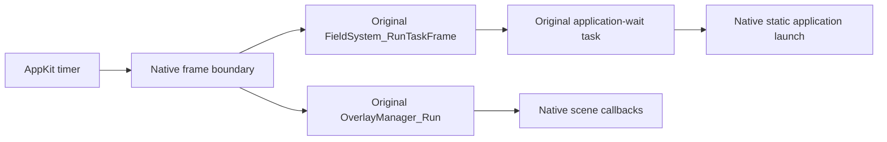

# Original field task and application execution

The native app now compiles, links and executes the complete unchanged `src/task.c`, alongside the existing original `overlay_manager.c`. This connects original control-flow mechanisms that the field, scripts, menus and battle launchers use. It does not yet execute original avatar updates or the complete `FieldMap` overlay.

## Actual running path

The scene application's native root callback calls original `CallApplicationAsTask`. Original `TaskManager_Call` pushes its child, whose original `Task_RunApplicationUntilComplete` launches the application through an explicit native boundary and waits for it to finish. Original `OverlayManager_Run` drives native scene init/exec/exit. After completion, the original waiting task releases its environment; original `FieldSystem_RunTaskFrame` unwinds the child and resumes/completes its parent.

The native window schedules a nominal 60 Hz main-run-loop timer. Callbacks sample a monotonic clock and advance original field-task/application dispatch for the elapsed 60 Hz ticks, with at most eight catch-up ticks per callback. The clock accumulator is shared with the existing system-task scheduler. This is host scheduling, not DS hardware/cycle emulation. See [movement performance](movement-performance.md). Rendering stays separate: camera events redraw the cached scene without advancing simulation. Character inspection has no scene application and its timer does no field work.

`HGFieldApp` initialization takes two deterministic ticks: the parent pushes the application-wait task, then the child launches and initializes the application. Closing/replacing a map requests native scene completion, lets original exec/exit finish, and drains the original waiting task and its parent before freeing their host context. Failed scene initialization follows the same cleanup path. There is no forced freeing of unknown task environments.

## Compatibility ownership

`src/compat/field_tasks.h` defines a **scoped native owner for `task.c`**, containing a task-stack pointer, one native application pointer and a host tick count. Although original C refers to it by the name `FieldSystem`, it is explicitly not the original complete `FieldSystem` layout or a DS ABI. It must not be passed to unported field units or guest ARM code. The task structure and its algorithms are declared/compiled from the original headers/source, with native pointers.

The script-manager and full field-system header bodies are excluded only in this integration scope because their unrelated SDK/save dependencies are not implemented. No original task algorithm is extracted or rewritten.

The native `FieldSystem_LaunchApplication` boundary admits one linked application at a time and creates its original overlay manager. Application-running status reflects actual native ownership; this host has no secondary application channel. Original field-overlay load/status providers remain explicit aborting boundaries. `FieldSystem_LoadFieldOverlay` and `sub_020505C8` therefore compile/link but remain unexecuted. No success stub pretends that the original field overlay loaded.

The other 13 task-unit functions are exercised directly or through nested execution in the behavior tests, including its two static helpers. This statement is based on the scenario's calls/assertions, not a new compiler-instrumented coverage trace or complete branch coverage. The existing prop trace still measures only its original scoped unit.

Original preconditions remain: callbacks that push a child must yield rather than return completion; otherwise the original dispatcher would act on a different current task. The original duplicated condition in `TaskManager_Jump` is unchanged. `Task_New` does not initialize the auxiliary `unk1C->unk0`; the test initializes it explicitly before testing its getter. The native viewer never reads that uninitialized value.

Heap-at-end allocation now lives in the shared heap boundary, rather than the prop adapter, so task execution does not depend on prop services. Host allocation semantics remain distinct from DS heap placement.

## Verification

`original_field_task_flow` tests child yielding and parent resumption, jump/state reset and owned scratch cleanup, application init/exec/exit yields, waiting until actual completion, repeated task-stack destruction, and the auxiliary getter after initialization. It also advances the real New Bark application for 120 deterministic ticks and verifies redraws do not add ticks. Invalid scene initialization must unwind cleanly.

The native UI smoke test verifies the timer advances before its existing camera/map/character/navigation checks. The normal and ASan/UBSan CTest suites cover this integration. Upstream remains unchanged.

This is an executable control-flow foundation, not a playable game. The next dependency is binding original avatar/object updates and input to this owner, with correctly scoped data layouts and original collision/event decisions. Existing `SysTask` queues are a different scheduling mechanism: they are independently tested but are not automatically dispatched by this new field-task timer.

The [transition integration](original-transitions.md) extends the scoped native `FieldSystem` owner with typed location, event, map-object-manager and save-owner fields for specifically admitted original code. It remains a native compatibility declaration, not the serialized DS layout or proof that arbitrary field units can run. Door/stair scene replacement occurs within the existing native scene callback and preserves the same original application/task owner; original field-transition task choreography remains unexecuted.
