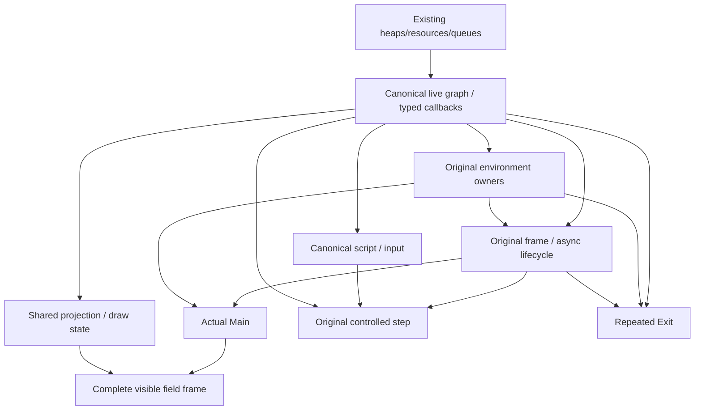

# Original-engine ownership audit and migration plan

## Decision

**The current application executes substantial original game logic, but the
original engine does not own the game end to end.** It is a native gameplay
controller built around original interpreters, task primitives, selected game
functions and interpreted ARM routines. That distinction matters for finishing
Johto: event ordering, application return, NPC scheduling and transitions are
currently responsibilities of custom controllers.

Recommend a **staged transfer of ownership**, preserving the working platform
backends and existing game-function implementations. Before extending ordinary
trainer victory/loss handling, establish the feasibility and cost of the original
field/process/script owners on those backends. Do not discard the working port,
start a second gameplay engine, or assume that compiling `main.c` alone will
restore original ownership. A complete Nitro/NNS graphics compatibility layer
could be more expensive than the gameplay scaffolding it replaces; its required
surface must be measured first.

Directional effort estimate: incremental ownership restoration is likely to
reduce **full-game** implementation and integration effort, with medium
confidence. A big-bang switch to original startup plus the entire original
graphics/application stack has an unknown, potentially higher cost. Neither is
already demonstrated by the current build. Section 8 gives the cost model and
decision gates.

## 1. Scope and evidence

Audit date: 2026-10-22. Repository HEAD: `85e6a4c`, **plus the existing dirty
working tree**, including the previous trainer-service work. References below
are to that working tree, not a claim that HEAD contains all these changes.
Gameplay implementation was paused for this audit. No implementation or
refactoring changes were made.

Evidence collected:

- Current `build/compile_commands.json`, generated provenance, the viewer's
  actual Mach-O symbols, original and compatibility source, and targeted
  compiler probes using the existing corpus-audit compilation context.
- Fresh executions of `test_field_tasks`, `test_starter`, `test_motion`,
  `test_battle`, `test_trainer_events` and `test_audio`: all exited 0.
  `test_violet --probe` exited 1 at the known ordinary trainer battle boundary.
- Raw commands, compiler diagnostics, symbol inventory and scenario output are
  ignored local artifacts under `build/audit/original-engine-ownership/`.
  These artifacts are supplementary; the findings and reproduction details
  needed to understand the decision are recorded here.

Reproduction records: `viewer-symbols.txt`, `compile-probes.json` and
`verified-executions.json` in that directory. The probes use the recorded
corpus-audit command with `-c/-o` replaced by `-fsyntax-only`; they do not alter
or add production build targets. First diagnostics were:

| Whole original unit | First current compatibility-context barrier |
| --- | --- |
| `src/main.c` | `FSOverlayID` undeclared; `nitro/gx/g2.h` missing. |
| `src/field_system.c` | `nnsys.h` missing through `field/overlay_01_02204004.h`. |
| `src/field/fieldmap.c` | Same NNS header dependency. |
| `src/field/field_control.c` | Same NNS header dependency. |
| `src/script_manager.c` | `PLAYER_NAME_LENGTH` undeclared through `pokemon_types_def.h`. |
| `src/field_warp_tasks.c` | `FSOverlayID` and Pokemon header/type boundary errors. |

These failures are specific to the current compatibility build context, not
proof that the original sources are intrinsically unportable. Later compiler,
linker, callback and runtime barriers remain after these first diagnostics.

**Trace limitation:** LLDB resolved the requested symbols but all three launches
stalled before reporting a breakpoint stop. A bounded `sample` fallback also
timed out. The audit-owned debugger processes were terminated. Consequently,
the call chains in section 3 are **source-reconstructed, execution-backed paths**,
not captured debugger stacks. Scenario assertions establish execution of the
tested services; they do not establish every callback on every branch. No
original startup/field-loop execution is claimed. This limitation does not
explain the ownership gap: the original roots are absent from the executable.

The initial investigation established a falsifiable hypothesis: the missing
ownership is caused by incompatible owner/lifecycle contracts as well as SDK
dependencies, rather than an overlooked call to an otherwise complete loop.
The decisive checks were the actual root-symbol inventory, compatibility
implementations and fresh whole-unit compiler probes. Subsequent discovery used
batched original call inventories and existing provenance instead of compiling
one missing gameplay command at a time. The complete engine/platform transitive
closure remains open; this document does not label first compiler errors as a
complete dependency list or derive a schedule from them.

## 2. Original owners versus current owners

### Original execution path

The game-level original entry is
[`NitroMain`, `src/main.c:48`](../upstream/pokeheartgold/src/main.c#L48).
DS boot/CRT and ARM7 firmware precede it; neither needs to be a native macOS
process entry. Preserving the game loop does require implementing its platform
contracts rather than manually reproducing its game decisions.

```text
NitroMain
  InitSystemForTheGame / graphics / input / RTC / SaveData / sound
  RegisterMainOverlay(intro movie, or reset-to-Continue)
  repeat:
    read input, reset/lid handling
    Main_RunOverlayManager
    original main and print task queues (under the original gate)
    RTC / graphics swap / print queue / VBlank wait
    brightness / fade / registered callback / sound / VWait queue

Main_RunOverlayManager -> original OverlayManager init / exec / exit
  intro -> title -> save/menu/new-game applications
  gApplication_NewGameFieldsys or gApplication_ContinueFieldsys
    FieldSystem_New -> overlay-124 FieldSystem_Init
    original new-game or Continue task
    Field_AppExec -> FieldSystem_Main
      FieldSystem_Control
      FieldSystem_RunTaskFrame
      field parent overlay OR child application
        field parent: FieldMap_Init / FieldMap_Main / FieldMap_Exit
```

Sources: [system initialization and VBlank](../upstream/pokeheartgold/src/system.c#L113),
[main overlay dispatch](../upstream/pokeheartgold/src/main.c#L140),
[field application templates](../upstream/pokeheartgold/src/field_system.c#L32),
[field initialization](../upstream/pokeheartgold/src/overlay_124.c#L21),
[field frame/process arbitration](../upstream/pokeheartgold/src/field_system.c#L182),
[field-map template](../upstream/pokeheartgold/src/field/field_3d_object_task.c#L10).
The title registers the save-check application at
[`title_screen.c:248`](../upstream/pokeheartgold/src/title_screen.c#L248).
The post-Oak and Continue application exits register the field applications at
[`overlay_36.c:135`](../upstream/pokeheartgold/src/overlay_36.c#L135) and
[`overlay_36.c:172`](../upstream/pokeheartgold/src/overlay_36.c#L172).
The current bedroom start is not evidence that this boot/title/Oak chain runs.

### Compilation, execution and continuous control

“Compiled” below distinguishes whole native C units from selected generated
slices and original ARM code executed by the bounded Thumb interpreter.
“Linked” does not itself prove execution.

| Original owner | Compilation/linkage in the current viewer | Executed evidence | Who continuously controls it now? |
| --- | --- | --- | --- |
| `NitroMain`, `Main_RunOverlayManager` | Original `src/main.c` is not a native build unit; both symbols absent. `src/main.c` in the host build is a different inventory program. | None for original startup. | AppKit `main` and `FieldCanvas` timer. |
| `InitSystemForTheGame` and original IRQ/frame phases | Original system initialization is not the viewer's startup path. | Scalar/platform services and isolated queue tests, not original system boot. | Native frame clock and `hg_field_app_advance`. |
| `SysTaskQueue_*`, `sys_task_api.c`, task environments | Original C units compile. `SysTaskQueue_RunTasks` is linked. | Queue mutation/order tests; battle private queue. | Host drivers choose when queues run. `hg_scheduler_step` is absent from the viewer symbol inventory; the full four-queue original frame is not its driver. |
| Field `TaskManager` stack | Whole original `task.c` compiles and links. | Child/yield/jump/application wait/cleanup tests; starter; outer viewer application. | It continuously runs a **native** scene application through the native field-task pump. Original stack mechanics are real; the game-level callbacks differ. |
| `OverlayManager` | Whole original `overlay_manager.c` compiles and links. | Init/exec/exit tests, viewer scene, starter and phone paths. | Original generic state machine, largely native callback descriptors/presentation implementations. This is useful reuse, not original field-process ownership. |
| `FieldSystem_New/Main/Control`, original process manager | Original `field_system.c` not built as a unit; main/control symbols absent. | None for original continuous field owner. | `HGFieldApp`, `HGFieldPlayer` and scoped `FieldSystem` objects. |
| `FieldMap_Init/Main/Exit` | Original `fieldmap.c` and its parent template unit not built; root symbols absent. | Resource readers/renderers and selected helpers execute separately. | Native scene initialization, per-frame policy and staged map/view swaps. |
| `FieldInput_Update/Process`, per-step controller | Whole field controller not built. Selected interaction/transition functions are generated slices. `FieldInput_Process` absent. | Collision, interaction selectors, warp selectors and route scenarios. | Native key handling, step completion, event priority and encounter dispatch. |
| Map-object lifecycle and callbacks | Whole original `map_object.c` compiles through a compatibility unit; many original getters/initializers execute. Movement assembly runs selectively in Thumb. | Explicit player/follower/script motion and static reset fixtures. | Native object arrays and explicit ticks; ordinary NPC autonomous task/callback lifecycle is not established. |
| Script VM and script environment | Whole original `script.c` compiles; original handlers are selected slices. Original `script_manager.c` is not a whole build unit; `Task_RunScripts` absent. | Original bytecode/handlers on admitted events. | `HGFieldScript` owns environments, attributes, child contexts, preview/replay, menus and publication. |
| Battle encounter/application owner | Original `encounter.c` and full `Battle_Run` lifecycle are not the current driver. `SetupAndStartTrainerBattle` absent under its original name. | Wild/rival/Tutorial and engine-only Falkner scenarios use the native battle owner. | Native request flag -> `HGBattle` -> explicit commit -> native field/script return. |
| Battle turn logic | Selected original controller/player/script/AI functions compile; AI and other ARM portions use Thumb. | Real damage, EXP, items, switches, captures and trainer-AI tests. | `hg_battle_tick` schedules the private queue, packet presentation and original `BattleContext_Main`. |
| Save persistence manager | Whole generated original `save.c` with two explicit bounds-order fixes; original registry/record services plus ARM callbacks. | Save/recovery/reopen tests and connected admitted gameplay. | Original persistence algorithms; native Save UI, safe-point preparation and field reconstruction. Original Continue application/task chain is not established. |

Build anchors: [CMake original queues](../CMakeLists.txt#L102),
[overlay/task targets](../CMakeLists.txt#L194),
[native map-object inclusion](../src/compat/map_objects.c#L5),
[script target](../CMakeLists.txt#L304),
[battle driver](../src/compat/battle.c#L135).
The authoritative selection lists are the generated provenance, not a count of
functions in an upstream translation unit.

**Important symbol trap:** the viewer has a local symbol named
`StartMapSceneScript`. It is the phone-time adapter at
[`src/compat/field_time.c:76`](../src/compat/field_time.c#L76), which recognizes
script 2047 and sets `forced=1`. It is not the original script launcher at
[`upstream/.../script_manager.c:66`](../upstream/pokeheartgold/src/script_manager.c#L66).
Symbol-name matching alone would give the wrong ownership answer.

## 3. Execution-backed traces of the current port

These traces combine explicit source edges with the fresh scenario results
listed above. They are not assertions that the original complete loop runs.

### Viewer frame and walking

```text
FieldCanvas NSTimer (field_viewer.m:50)
  hg_field_app_advance -> hg_field_app_step (field_app.c:511)
    hg_field_tasks_tick(app->runtime) (compat/field_tasks.c:11)
      original FieldSystem_RunTaskFrame
      original OverlayManager_Run
        native scene_exec (field_app.c:305)
          native transition / battle / menu / input arbitration
          hg_field_player_move / tick (field_player.c:503,596)
            original collision / movement functions through motion_guest
          completed step:
            coordinate event -> downward ladder probe -> encounter
```

The actual native scene template is installed by
[`run_scene_application:472`](../src/field_app.c#L472), not by
`gApplication_NewGameFieldsys`. The original task and overlay mechanisms thus
surround a native controller. The native completion order is visible at
[`field_app.c:395`](../src/field_app.c#L395); the fuller original step policy is
[`FieldSystem_ProcessStep:632`](../upstream/pokeheartgold/src/field/field_control.c#L632).
The latter also handles gym actions, soundplates, forced movement, poison,
Safari/daycare and other branches that the native controller does not inherit
merely by using the original collision function.

`test_motion` passes; its intentional unsupported-boundary test prints a Thumb
fault before the final successful result. This is not evidence that the full
NPC controller runs. `test_violet --probe` prints routes 73 -> 110 -> 155 and
rejects opcode 213 at bank 953 byte 3123. That is a preflight failure: it does
not publish the preceding trainer dialogue as a live playable encounter.

### Starter task/application

```text
hg_starter_begin / hg_starter_tick
  original starter task slices
  hg_field_tasks_tick
    original TaskManager stack -> FieldSystem_LaunchApplication adapter
    original OverlayManager init / exec / exit
      native choice_init / choice_main / choice_exit
    original task resumes, creates the Pokemon, frees arguments
```

[`starter.c:28`](../src/compat/starter.c#L28) supplies the native picker callbacks;
[`starter.c:45`](../src/compat/starter.c#L45) aliases the original presentation
callback names. `test_starter` checks that party acquisition waits for actual
application completion and that cancellation drains the task. It proves an
important reusable lifecycle mechanism, not the original starter UI or complete
field process manager.

### Battle and return

```text
original ScrCmd_TrainerBattle slice
  native_start_trainer (field_script.c:238), not original encounter.c launcher
  battle_pending -> begin_script_battle (field_app.c:121)
    native HGBattle setup
    battle_frame -> hg_battle_tick
      private original SysTaskQueue_RunTasks
      native packet/menu presentation
      original BattleContext_Main
    native storage/party/result commit
    hg_field_script_battle_complete -> native field/script resume
```

The native script context's `taskman` is actually cast from `HGFieldScript`,
not an original `TaskManager`:
[`initialize:643`](../src/field_script.c#L643).
`TaskManager_GetFieldSystem` is macro-replaced at
[`field_script.c:151`](../src/field_script.c#L151).
**Removing only the trainer-ID restriction and calling the original encounter
launcher is therefore invalid.** Its real task/environment contract is absent.

The original route instead calls `SetupAndStartTrainerBattle` ->
`CallTask_StartEncounter` -> leave-overworld/battle child tasks -> result and
post-battle updates -> restore-overworld -> unpause/fade.
See [`encounter.c:116`](../upstream/pokeheartgold/src/encounter.c#L116),
[`encounter.c:696`](../upstream/pokeheartgold/src/encounter.c#L696) and
[`Battle_LaunchApp:180`](../upstream/pokeheartgold/src/launch_application.c#L180).
Its application executes the full
[`Battle_Run:45`](../upstream/pokeheartgold/src/battle/battle_022378C0.c#L45)
state machine, including end/evolution states. Current battle-context execution
does not prove those states work.

### Save and Continue

```text
native Save action -> clone complete save owner -> native field/object safe point
  -> original save manager + native flash transport -> native publication
native Continue -> original manager load -> original admitted time updates
  -> native app_new_state / player resume / saved-object reconstruction
```

Sources: [`field_app.c:758`](../src/field_app.c#L758),
[`field_app.c:784`](../src/field_app.c#L784),
[`field_player.c:971`](../src/field_player.c#L971).
This retains the real persistence kernel. It does not execute
[`Field_Continue_AppInit:55`](../upstream/pokeheartgold/src/field_system.c#L55)
and [`FieldTask_ContinueGame_Normal:415`](../upstream/pokeheartgold/src/field_warp_tasks.c#L415).
Those contain additional original reconstruction/continuation policy.

## 4. Concrete blockers and dependency chains

The following are demonstrated blockers and original dependency chains, not a
claim that all downstream platform leaves have already been resolved.

### B1. Boot/frame contracts and native module lifecycle

`NitroMain` -> `InitSystemForTheGame` -> OS arenas/IRQ, FX, GX, filesystem,
four queues; graphics initialization additionally writes DS VRAM/OAM/palette
addresses. The root loop requires input, RTC, fade/brightness, sound and VBlank
semantics. See [`system.c:113`](../upstream/pokeheartgold/src/system.c#L113)
and graphics setup immediately afterward.

The compatibility overlay loader only accepts explicitly registered modules
and **`OVY_LOAD_ASYNC`** at
[`compat/overlays.c:17`](../src/compat/overlays.c#L17), whereas
`Main_RunOverlayManager` requests **`OVY_LOAD_NORMAL`**. Renaming or statically
linking overlays alone does not close startup.

The original loop runs the print queue at two sites, conditionally runs main
tasks, and has a separate IRQ-driven VBlank queue
([`system.c:20`](../upstream/pokeheartgold/src/system.c#L20)). The reusable queue
implementation is present, but `hg_scheduler_step`'s once-per-queue host order
([`scheduler.c:40`](../src/compat/scheduler.c#L40)) is not equivalent to this loop.
Do not make both pumps active and double-tick tasks.

Fresh whole-unit probe: original `main.c` currently reports undeclared
`FSOverlayID` and missing `nitro/gx/g2.h`. These are first declaration barriers;
fixing them would not implement the contracts above or link all startup apps.

### B2. Incompatible field ownership and live-object ABI

Original `FieldSystem_New` -> `FieldSystem_Init` -> save location, events,
matrix, cursors, phone and auxiliary owners. Original `FieldSystem_Main` expects
`processManager->{parent,child,isPaused,isDone}` and `runningFieldMap`.
The actual native definition deliberately suppresses the original header and
supplies a different owner at
[`compat/field_tasks.h:3`](../src/compat/field_tasks.h#L3).
Compare [`original field_system.h:175`](../upstream/pokeheartgold/include/field_system.h#L175).

Original task application status checks two original process states. Current
`sub_0203DF7C` checks one `application` slot, `sub_0203DFA4` always returns false,
and field-status/load functions abort:
[`compat/field_tasks.c:2`](../src/compat/field_tasks.c#L2).
These are explicit scoped boundaries, not compatible replacements for the full
original process manager.

Native C pointers widen to 64 bits. Original assembly consumes fixed DS offsets
and function pointers. The current Thumb bridge uses handles and marshaled
records, not arbitrary native object pointers
([`motion_guest.c:386`](../src/motion_guest.c#L386)). Original `FieldSystem`
cannot be passed directly to those guest routines, nor can the current fake
field structure be passed to unported original C. The migration must close each
reachable C/ARM object-and-callback graph, including cycles, rather than rely on
matching a few scalar offsets. Existing save-record ABI checks do not validate
pointer-bearing runtime structures. Also audit native C pointer/integer casts;
`map_object.c:855` is an existing concrete example.

### B3. Field-map initialization and presentation/resource contracts

Original field parent template -> `FieldMap_Init` -> native-visible scene state:

```text
FieldMap_Init
  overlay/heap setup, DS protection checks, BG/OAM/VRAM managers
  InitGraphicsAndManagers
    area data / model attributes / render objects / texture managers
  FieldSystem_InitMapLoadManager
    MapLoadManager_New / InitialLoad -> map chunks / terrain / object setup
  weather, map script hooks, sound, HBlank, bottom-screen application
  runningFieldMap = TRUE only after initialization completes
```

Exact roots: [`fieldmap.c:119`](../upstream/pokeheartgold/src/field/fieldmap.c#L119),
[`InitGraphicsAndManagers:654`](../upstream/pokeheartgold/src/field/fieldmap.c#L654),
[`FieldSystem_InitMapLoadManager:673`](../upstream/pokeheartgold/src/field/fieldmap.c#L673),
[`MapLoadManager_New`](../upstream/pokeheartgold/asm/overlay_01_021F4704.s#L3371),
[`InitialLoad`](../upstream/pokeheartgold/asm/overlay_01_021F4704.s#L3492),
[bottom-screen initialization](../upstream/pokeheartgold/asm/overlay_01_021EAF00.s#L33).

The current model/NARC/texture/raster services are valuable, but they are not
implementations of the original NNS resource/renderer APIs and manager object
contracts. Whole-unit probes of field system, field map and field controller
all stop at missing `nnsys.h` via `field/overlay_01_02204004.h`. That is a shared
header dependency, **not three independent implementations to patch**.

The original initialization also evaluates DS protection routines and uses
their results to schedule failure behavior or perturb initialization
([`overlay_124.c:21`](../upstream/pokeheartgold/src/overlay_124.c#L21),
[`fieldmap.c:119`](../upstream/pokeheartgold/src/field/fieldmap.c#L119)). Their
machine/code assumptions require explicit native-port investigation. No result
for them was supplied or tested by this audit; blindly returning success or
pretending their original ARM checks execute would be unsound.

### B4. Walking, autonomous objects and interaction/script ownership

`FieldSystem_Control` -> `FieldInput_Update/Process` -> trainer sight, per-step
policy, interact/menu/registered-item actions -> `PlayerAvatar_MoveControl`.
`StartMapSceneScript` -> `ScriptEnvironment_New/SetupScriptEngine` -> **real**
`FieldSystem_CreateTask(Task_RunScripts)` -> original contexts/strings/message
format/cleanup. These are coherent owners already present in source
([`field_system.c:207`](../upstream/pokeheartgold/src/field_system.c#L207),
[`field_control.c:193`](../upstream/pokeheartgold/src/field/field_control.c#L193),
[`script_manager.c:66`](../upstream/pokeheartgold/src/script_manager.c#L66)).

Original object creation registers autonomous tasks at
[`map_object.c:600`](../upstream/pokeheartgold/src/map_object.c#L600), which call
[`sub_0205F12C:893`](../upstream/pokeheartgold/src/map_object.c#L893) and original
movement callback dispatch. Current event initialization deliberately stops
short of this graph
([`compat/map_objects.c:16`](../src/compat/map_objects.c#L16)). The viewer does
not initialize/drive the original global four-queue scheduler. Its original
battle queue calls are redirected to a private battle queue
([`battle_providers.inc:181`](../src/compat/battle_providers.inc#L181)).
Starting autonomous NPC tasks therefore requires queue ownership **and** real
callback initialization, not just enabling another movement number.

The script-manager contract additionally conflicts with `HGFieldScript`'s
replacement attributes, native UTF-8 `MessageFormat`, pseudo task pointer and
preflight forks. The fresh original script-manager probe reports missing
`PLAYER_NAME_LENGTH` through native/header boundary suppression. This exposes
an include/type integration problem; it is not the full runtime closure.

### B5. Encounter/application/result/field-return ownership

`ScrCmd_TrainerBattle` -> original `SetupAndStartTrainerBattle` -> real
`BattleSetup`, opponent data, transition/music selectors -> original encounter
task -> `CallTask_LeaveOverworld` -> `Battle_LaunchApp` -> `Battle_Run` ->
post-battle updates/result/loss branch -> `CallTask_RestoreOverworld` ->
unpause/fade/task unwind. The leave/restore tasks are original assembly at
[`unk_02055244.s:22`](../upstream/pokeheartgold/asm/unk_02055244.s#L22) and
[:60](../upstream/pokeheartgold/asm/unk_02055244.s#L60).

Current script battle requests and outcome preflight replace this chain.
`hg_field_script_battle_complete` heals trainer losses directly
([`field_script.c:1039`](../src/field_script.c#L1039)), an admitted first-rival
behavior, not general original trainer-loss ownership. `field_app.c` manually
commits rewards/party/storage and chooses return/recovery. Continuing to extend
these branches would implement more of the original encounter owner by hand.

Full `Battle_Run` also owns battle initialization, teardown and evolution; its
render/input, BG/palette/OAM and application dependencies must be closed before
claiming original battle application ownership. Existing turn-logic tests are
strong reusable evidence, but not a substitute for that lifecycle.

### B6. Original transitions, startup and Continue

Original new-game and Continue field tasks prepare events/maps/objects and call
the field overlay chain
([`field_warp_tasks.c:386`](../upstream/pokeheartgold/src/field_warp_tasks.c#L386)).
Script and ordinary warps also leave/rebuild/restore through original tasks.
Current `transition_frame` manually sequences door playback, fades, scene swap,
threshold step and follower restoration. The selectors and kernels are reused;
the original transition task chain is not.

Original SaveData persistence is already a strong implementation; do not reopen
its 42-record/six-extra-record work merely because field ownership changes.
The remaining ownership gap is producer synchronization, original Continue
field/application reconstruction, and task/resource lifetimes. The original
warp-task probe currently encounters the same overlay/type/header boundary
family; these are shared blockers, not a missing disk-save implementation.

## 5. Native reconstruction and its intended fate

| Current code | Original responsibility it duplicates or narrows | Retain / retire |
| --- | --- | --- |
| `field_app.c:305` `scene_exec` | Field control, event priority, process/application arbitration, battle launch/return, transition phases and ambient-music policy. | Retire gameplay policy after original owners pass. Retain desktop presentation/input/clock bindings where appropriate. |
| `field_player.c:503,596,625,700` | Player motion scheduling, explicit object/script movement ticking, NPC interaction selection, script publication/population reconstruction. | Keep resource/object adapters initially; retire scheduling and interaction/script ownership in favor of original field/object/script managers. |
| `field_script.c:637,682,792,964` | Script environment, attributes, context scheduling, copied worlds, whole-script preview/replay, choice/outcome exploration and publication. | Keep original `script.c` and handlers; migrate the runtime to original `script_manager.c`. Session/test isolation may remain outside the engine; a second gameplay script scheduler should not. |
| `field_transition.c:98` and `field_app.c:224` | Selected transition admission and host-staged choreography around original selectors. | Reuse terrain/resources/animation implementation; transfer ordering and field destruction/recreation to original transition tasks. |
| `field_menu.c:17` and viewer controls | Bag/party UI navigation, medicine targeting, party swap and follower repair. | Desktop key mapping persists. Prefer original application/menu controllers and original data ownership; existing item-effect math and `Party_SwapSlots` reuse persists. |
| `compat/battle.c:135`, `battle_menu_host.inc`, `battle_view.m` | Private battle frame/event/menu owner, presentation completion, command/target UI and direct field publication. | Preserve original battle logic/assets and reusable drawing/audio. Migrate full encounter and application lifecycle; audit UI callback contracts before replacing more battle branches manually. |
| `compat/naming.c:9`, `starter.c:28`, `phone.c:119`, `mart.c:75` | Native presentation/state owners behind some original task/overlay mechanics; selected original transaction/call logic. | Original task/overlay reuse is useful. Native UI/backend work is not automatically wrong, but these are not the original applications end to end. Prefer adapting original controllers over adding missing application decisions here. |
| `compat/field_time.c:76` | Original script-launch name replaced with an incoming-call request flag. | Preserve RTC/account providers and original time updates. Retire the launcher shim when the real script/field owners can accept the request. |
| `HGStoryState`/scene clones, global RNG swaps, private battle task redirection | Multiple isolated owners replace the original single running field/application graph. | Useful fixture/failure-containment mechanisms today. Move isolation to whole test sessions; avoid making original resource graphs clonable just to keep this execution model. |
| Curated checkpoint teams and exploration mode | Deliberate developer features, not original progression. | Retain as opt-in test/debug tooling outside the production engine. Never use them as continuous-progression evidence. |

For scale only, `field_app.c`, `field_player.c`, `field_script.c`,
`field_transition.c` and `field_menu.c` currently total 3,276 lines. They mix
necessary adaptation with gameplay policy; that is **not** a deletable-line or
effort estimate. The concrete retirement targets above are more useful than
counting original functions compiled.

Two current behavior differences illustrate the ownership cost:

- `hg_battle_tick` returns on message/menu waits before running its private task
  queue. This is host scheduling policy, whereas the original global frame has
  its own task and UI-wait ordering. Passing admitted battles does not prove
  timing equivalence for other battle/background tasks.
- `hg_field_player_tick` does not run when its script owner is active; a separate
  `scene_tick` advances explicitly represented script/follower work. This has
  working regression coverage, but does not inherit arbitrary original NPC
  autonomous callbacks, trainer sight and field effects.

## 6. Review of the previous service changes

### Trainer actor reset

**Original logic reused:** static callback/type choices are extracted from the
original tables; original facing initializers and ordinary type initializer run
through Thumb. The empty original teardown and previous-position update execute.
The original overlay-26 helper is included at the native scene boundary.

**Necessary compatibility:** translating native object references to guest
handles, native resource ownership and statically resident module registration.
Binding the selected NPC ID was a real missing contract in the current owner.

**Temporary reconstruction:** `hg_motion_actor_reset` requires null original
movement callbacks and admits only old/new movements 14–17 and ordinary types
([`motion_guest.c:831`](../src/motion_guest.c#L831)). Original
[`sub_0205FC94:2006`](../upstream/pokeheartgold/src/map_object.c#L2006) instead
tears down the previous movement, installs its original callbacks and initializes
the new controller. Its native symbol is absent from the viewer. The small reset
bridge is not that original lifecycle. With original object ownership, its
movement admission/table-specific orchestration should disappear; the ABI/CPU
bridge may still be necessary. Success across 16 static pairs is not dynamic
trainer reset/sight/effect acceptance.

### Trainer dialogue

**Original logic reused:** unchanged `GetTrainerMessageByIdPair` selects from
the real trainer tables
([`trainer_data.c:103`](../upstream/pokeheartgold/src/trainer_data.c#L103)).
The native closure report has no open call edges for this bounded service,
and the table-pair tests exercise its resource traversal.

**Necessary compatibility:** reading NARCs, font/text rendering and a bounded
character/message decoding boundary on the host.

**Temporary reconstruction:**
[`compat/trainer_message.c:25`](../src/compat/trainer_message.c#L25) maps original
`String` operations to a bank/member reference, not an original populated String;
[`field_script.c:578`](../src/field_script.c#L578) replaces the trainer-message
handler's window/format/ack lifecycle. The added `message_window_open` flag is
written but not read in the current source. The native box may display correctly,
but this does not execute the original `OpenMsg`/`CloseMsg` BG/window lifecycle
([`scrcmd_c.c:682`](../upstream/pokeheartgold/src/scrcmd_c.c#L682)) or the original
[`ScrCmd_TrainerMessage:2400`](../upstream/pokeheartgold/src/scrcmd_c.c#L2400).
Once original script/message ownership is restored, retain resource/rendering
services and retire the selector-reference wrapper and special message opcode
presentation where the original message pipeline can handle them.

### Encounter music

**Original logic reused:** the class/region selector and table in
[`field_bgm.c:187`](../upstream/pokeheartgold/src/field_bgm.c#L187), called by the
original encounter-music handler.

**Necessary compatibility:** SDAT/SSEQ playback, mixing and native audio output.
Saving a paused voice/track position is a useful backend primitive, with exact
sample restoration and independent-clone checks.

**Temporary reconstruction:** `BGM_SaveStateAndPlayNew` is macro-replaced by
[`native_encounter_bgm:99`](../src/field_script.c#L99), and ambient restoration
is selected by [`field_app.c:460`](../src/field_app.c#L460). The original sound
save/pause routine is assembly at
[`unk_02004A44.s:1240`](../upstream/pokeheartgold/asm/unk_02004A44.s#L1240).
The tests prove the native primitive, not every original sound-handle/fade case.
Keep the backend capability; transfer the decision to save/play/restore to the
original sound/encounter/field owners as their contracts are ported.

### Save/Continue and checkpoints

The previous group added actor-movement cartridge write/load/reconstruction
evidence; it did **not** replace or newly implement the persistence kernel.
Other existing changes retain source checkpoint files by making a complete
cartridge copy in `hg_field_app_continue_copy`
([`field_app.c:831`](../src/field_app.c#L831)). That is useful host/test file
management, not duplicated game save-format logic.

The original persistence manager should remain. Its generated source has two
explicit predicate-order changes to avoid out-of-bounds access, documented in
[`prepare_save_manager.py:15`](../scripts/prepare_save_manager.py#L15);
calling it literally unchanged would be inaccurate. Native flash transport,
durability and ABI checks are appropriate compatibility work.

The replaceable pieces are the native save safe-point/UI/publication decisions
and field/Continue reconstruction. Test-team injection, party reordering and
source-file copying remain separate from legitimate acquisitions/progression.
Neither a valid cartridge nor a successful object fixture proves the original
Continue application, all later puzzle reconstruction, or a first badge.

## 7. Prioritized migration plan

### P0 — Bound feasibility before more gameplay policy

Next engineering outcome should be an **original field-ownership feasibility
checkpoint**, not another ordinary-trainer special case. This audit does not
authorize calling unresolved contracts successful.

1. Reuse the compiler/provenance/call tools to produce the actual transitive
   closure for `FieldSystem_New/Main`, field parent lifecycle,
   `FieldInput_Process`, original script manager and one encounter/return path.
   Resolve indirect targets from original descriptors, object movement/type
   tables and initialization; follow SCC exits. Separate required opening-map
   resources from branches requiring later map load types. Record all open
   SDK/assembly/lifetime edges; do not call the full closure complete yet.
2. Establish a canonical **original native-C live owner graph**. Evaluate original
   declarations compiled with typed SDK interfaces and native-only sidecars.
   Do not extend the fake `FieldSystem` until it superficially matches arbitrary
   original units. Inventory every reachable ARM consumer and its fixed-offset
   graph: bridge it explicitly or translate that original unit to native code.
   Never pass widened native pointers into unmodified ARM routines.
3. Measure the smallest coherent graphics/resource bridge required to complete
   original static-map initialization and teardown on existing DS resource and
   raster services. A native presentation backend may be retained; fake manager
   objects or “initialization complete” stubs are not a valid feasibility pass.

Compatibility services should implement machine/resource operations without
reading story state to decide which original gameplay branch to simulate.
Original owner bodies should remain upstream code, with explicit reviewed
machine/undefined-behavior adaptations where required. An unsupported reachable
contract must fail visibly; returning a convenient false/true to skip original
work is not an ownership migration.

**Go/no-go evidence:** original field constructor/process owner and one complete
parent init/exec/exit cycle execute with valid resources and real lifetimes;
all imports on that path have implementations, bounded unsupported branches or
explicit open classification. If NNS/resource graphs cannot be adapted without
reimplementing comparable game policy, revise the split before broad migration.
Do not erase the working viewer to perform this probe.

### P1 — One original field/frame/object owner

Bring up original `FieldSystem_Main/Control`, input processing and object
callbacks on the canonical owner, initially through an explicit test harness.
The harness is not production startup acceptance. Ensure one authoritative
simulation writer and one clock; initialize/run the original queues with correct
phases. Keep AppKit as event collection/display, not the gameplay scheduler.

**Acceptance:** walk/run/collision and input-release behavior on the existing
opening maps; autonomous NPC callback creation/ticking/destruction; follower
movement; pause during a field task; correct interaction/step/transition priority.
Capture frame/task/callback traces when debugger access is available. A build or
an idle map is insufficient. Retire the corresponding native motion/event
arbitration rather than running both controllers.

### P2 — Original script environment and application process ownership

Use `StartMapSceneScript`, `SetupScriptEngine`, `Task_RunScripts` and actual
`ScriptEnvironment` attributes/contexts/strings on the real task stack. Preserve
the existing original VM and opcode bodies. Port shared message/window/input
services beneath that owner. Extend the real parent/child field process manager;
preserve original init/exec/exit and argument cleanup for starter/phone/menu apps.

**Acceptance:** original interaction, nested standard script, movement wait,
independent script contexts, refusal/cancel, actual application completion and
post-application interaction. Replace fake task pointers and per-script copied
world publication. Keep unsupported-service failure visible; keep fixture and
session rollback outside the production script scheduler.

### P3 — Original encounter, battle application and return

Reuse `encounter.c`/`BattleSetup` and original leave/restore tasks. Connect the
real battle application descriptor and `Battle_Run` lifecycle to typed native
graphics/input/audio services, reusing already compiled turn logic and AI.
If temporarily adapting the existing battle presenter, label that intermediate
accurately: original encounter/task ownership is possible before the full battle
UI is ported, but a wrapper around `hg_battle_tick` is not original `Battle_Run`.

**Acceptance:** wild battle and rival; ordinary trainer victory **and** loss;
original result/reward publication exactly once; blackout ownership; parent
field exit/rebuild; movement/callback/input recovery; repeat interaction;
move-learning/evolution branches when applicable. Retire native
`battle_pending`/healing/result-publication logic when the original owner takes
over. Do not add a second outcome state machine beside it.

### P4 — Original travel and Continue reconstruction

Complete original warp/load/door/leave/restore chains and original Continue
field task using the existing save manager/flash and original object-save
functions. Reuse the current portal, scene, healing, failure and durable-resume
scenarios. Transfer resource lifetime and transition ordering from native
`transition_phase` to the original task chain.

**Acceptance:** stairs and both ladder directions, exterior/interior doors,
follower placement, native scene after cancel/failure, Save/process exit/Continue,
and a puzzle/object state that needs more than player coordinates. Preserve all
records and existing passing persistence acceptance; no flags or team injection.

### P5 — Original startup loop and application chain

Run `NitroMain` with native OS/input/filesystem/IRQ/graphics/sound contracts and
the original main overlay dispatcher. A candidate host boundary is an engine
thread with `OS_WaitIrq` waiting for host frame/interrupt events, while AppKit
handles its required UI thread. That is a design option, not executed evidence;
validate thread assumptions and all callback phases before choosing it.
Alternatively use a host execution mechanism preserving the same original loop
ordering. Do not maintain a copied second main-loop body.

Wire original title/save-check/menu/post-Oak/Continue descriptors and their
actual lifecycle. Raw DS boot, ARM7 execution and DS executable relocation are
not required if equivalent platform services and statically resident modules
preserve the relevant original contracts. Normal/async load modes and field
parent/child lifetime must genuinely work; no permanently successful loaders.

**Acceptance:** original startup -> original new game -> field, and a separate
process original startup -> Continue -> field -> battle -> field. Then repeat
the connected gameplay-produced chapter route. P1–P4 test entries cannot be
relabeled full startup. Working full startup sooner is desirable if the measured
closure makes it cheaper; title/Oak graphics are not prerequisites for proving
the field ownership hypothesis in a harness.

### P6 — Finish Johto by shared original services, then chapters

Only after ownership gates pass, continue the gameplay-produced Violet/first
badge route and shared services toward Lance/credits. Later gym/puzzle/cutscene
work should bind original resources and service families, rather than add
per-chapter field controllers. Keep varied six-Pokemon fixtures as feature
coverage, separate from uninterrupted progression. Preserve existing scenario
drivers and original behavior checks as migration oracles, not replacement logic.

## 8. Effort, reuse and decision criteria

| Strategy | Upfront cost | Cost repeated across the game | Assessment |
| --- | --- | --- | --- |
| Continue the current leaf/service admission approach as the permanent architecture | Lowest cost to another narrow opening feature. | Host event ordering, missing application logic, transitions, movement callbacks, return/publication and unsupported branches continue to grow. | Useful for feasibility/tests; poor default for the entire game given the demonstrated ownership gaps. |
| Replace everything with original startup and a full Nitro/NNS runtime immediately | Largest uncertain ABI, graphics, initialization, audio and application closure. | Potentially low game-policy reconstruction after the platform works. | Not justified yet; “compile the engine” hides substantial unresolved dependencies. |
| Incremental original owners with retained native platform/presentation backends | Real owner/ABI/process work plus a measured static-map SDK bridge; temporary old/new coexistence in separate test paths. | Shared owners inherit original behavior; fewer independent gameplay state machines to maintain. | Recommended, conditional on P0/P1 proving the resource/ABI cost is bounded. |

Let `M` be owner/ABI migration and regression cost, `P` the additional required
platform/presentation contracts, and `R` the remaining original-service binding
work. Let `C` be future custom gameplay/controller work and `I` its repeated
integration/behavior-equivalence cost. Switching reduces total effort when
`M + P + R < C + I`. Already implemented platform code is reusable in both
alternatives; counting it again as a complete rewrite would bias the estimate.
Equally, assuming `P = 0` because models already render would bias it the other way.

Concrete reasons to expect savings: the original field controller already joins
trainer sight, interactions, per-step effects and menus; original script manager
owns contexts and attributes; original encounter and battle application own
loss/return/evolution; original warp tasks own leave/load/restore. Current work
has separately reconstructed parts of each. These are several system families
used throughout all chapters, not a one-off first-badge optimization.

Concrete costs against switching: original live pointer graphs cross ARM/native
boundaries; field init pulls NNS/resource and bottom-screen managers; original
startup pulls title/Oak/menu and DS system/protection assumptions; application
input/rendering and battle initialization remain incomplete. The six compiler
probes identify first barriers, not a priced full port. A credible person-week
or completion-date estimate cannot be extracted from this evidence. Confidence
in **net savings is medium for incremental ownership, low for big-bang full SDK
replacement**. P0 must turn the major unknown `P` into a finite contract worklist
before committing to the latter.

### Reusable runtime versus temporary HeartGold scaffolding

- **Reusable DS/native runtime:** scalar/fixed-point types, queues and host clock/
  IRQ interface, native allocation/filesystem/flash durability, resource formats,
  decompression, geometry/texture/animation/raster backends, audio synthesis/output,
  input/display bindings and the bounded ARM interpreter with typed ABI bridges.
  Existing parsers/renderers should be extended, not duplicated with a second set.
- **Original HeartGold logic to retain:** task/overlay/VM primitives; Pokemon/item/
  save algorithms and records; battle controllers/AI; script/event data; existing
  original field/transition helpers. Moving their owner does not require rewriting
  the algorithms that already work.
- **Temporary HeartGold execution scaffolding:** `HGFieldApp` scene policy,
  `HGFieldPlayer` explicit gameplay scheduling, `HGFieldScript` environment/fork
  runtime, pseudo task/attribute ownership, copied battle publication, narrowed
  application/status shims and hand-staged travel. Retire by accepted ownership
  boundary, not wholesale deletion in advance.
- **Permanent developer tools:** checkpoint copying, curated team injection,
  exploration, route drivers and evidence/audit tooling, isolated from production
  progression and the original runtime's decisions.

The next implementation decision should be judged by an observable transfer of
control and removal of duplicate policy. Passing one more opcode or reporting a
closed leaf call graph does not answer this architectural question. The existing
working route is valuable evidence and a fallback during migration, but it is not
evidence that continuing manual gameplay orchestration is the cheapest way to
finish HeartGold.

## 9. P0 implementation checkpoint — isolated native owner mechanisms

P0 has begun; **the constructor and original field-map lifecycle gate has not
passed, and P1 is not ready**. The production viewer and its native controllers
remain intact. No original startup, field control, map initialization or original
script-manager execution is newly claimed by this checkpoint.

The isolated `test_original_field_owner` target now compiles the **complete
original `FieldSystem` declaration**, including its original embedded `FollowMon`
and menu-input state. `scripts/prepare_original_field.py` projects these
declarations unchanged from upstream and verifies every opaque pointer target's
original struct tag. It does not append host fields, recreate DS offsets or cast
native pointers into ARM records. Pointer targets are opaque until their own
native/guest contracts are resolved; this does not establish a compatible
transitive live-object graph. This projection avoids importing unrelated embedded
NNS manager definitions merely to compile the owner. It is not a second layout
maintained by hand. The existing scoped viewer definition remains isolated in
different translation units and executables.

The harness compiles whole original `task.c` against that declaration and executes
seven unchanged selected bodies from original `field_system.c`, including
`FieldSystem_Main`, application launch/status and completed-overlay deletion.
Generated provenance records their source hashes. It reuses `hg_logic` allocation
and `hg_overlays`; it does not link `compat/field_tasks.c`. Tests exercise parent
priority over a waiting child, original overlay init/exec/exit mechanisms, parent
unload, child completion, task resume on the next frame and final done publication.
**Its application descriptors and `FieldSystem_Control` are test doubles.** An
attempt to load the real field parent aborts explicitly. A synthetic overlay cycle
is not `FieldMap_Init/Main/Exit` evidence, and the harness is not wired to the
viewer. Original constructor/init/delete are not included yet.

Reproduce the source inventory and mechanism checks:

```sh
python3 scripts/audit_original_field.py
cmake -S . -B build
cmake --build build --target test_original_field_owner -j 6
./build/test_original_field_owner
python3 -m unittest discover -s tests -p test_original_field_audit.py
```

The original-source mode extends the existing cached dependency index rather
than replacing its compiler-resolved native mode. It adds scalar descriptors
(including `ov01_02206378`), which the previous array-only data parser missed,
and excludes host/generated definitions. Thus the phone `StartMapSceneScript`
shim cannot resolve an original edge. All requested owner roots, the constructor
destructor and the trainer encounter root share one traversal; SCC outgoing edges
are retained. The ignored reports under `build/audit/original-field/` retain
source/line provenance, per-root consumers, ambiguous candidates, missing symbols
and indirect calls. Source cache invalidation hashes inputs and extractor code;
rerunning the audit regenerates the reports. These are conservative lexical
inventories, not compiler-proven complete closures. Conditional scopes, indirect
target proofs, opening-resource selection and initialization/publication/resume
contracts remain open.

The first unrestricted inventory expanded to 46,154 nodes, with every root group
reaching the same large graph. This result was inflated by inline assembly labels
resolving unrelated overlay data; section 10 records the correction. It was
**not a measured minimum SDK surface**. Original allocation failure also genuinely
reaches error/reset/menu applications, and phone/script callbacks reach broad
script dispatch. Missing/indirect/ambiguous edge counts include lexical and
preprocessor uncertainty; they are not counts of missing implementations. A second
`platform-contracts.json` view cuts named allocator/module/assertion and SDK
contracts, labels every cut unverified and preserves the unrestricted report.
That view still expands broadly through game callbacks. Neither report justifies
implementing the entire graph or declaring a closure complete. The useful next
reduction requires original table/store target proofs and a bounded opening-map
execution trace, rather than another symbol-name allowlist.

The next implementation boundary is the real constructor on this owner:
`FieldSystem_New -> overlay_124 FieldSystem_Init`, with original location/save,
matrix/events/cursors/phone ownership and matching destruction. Reuse the existing
matrix, resource, save and allocation implementations only after matching their
contracts. `Heap_Create/Destroy`, DS protection callbacks and static overlay-124
registration are unresolved, not successful stubs. The original destructor also
requires lifetime investigation for constructor allocations such as `unk108`;
do not assume synthetic mechanism tests establish leak-free field lifetimes.

The following shared presentation boundary is larger than a missing `nnsys.h`:
`InitGraphicsAndManagers` allocates area/render/animation managers, then
`MapLoadManager_New/InitialLoad` crosses original ARM live graphs, and bottom-screen
startup crosses another ARM owner. `FieldMap_Exit` ticks the map loader before
teardown, waits for its end, then waits for bottom-screen completion before
destroying the heap. Existing `compat/props.h` has a native render-object
representation; `compat/prop_animation.c` has a scoped allocator placeholder.
Neither should be exported as a complete NNS ABI or used to fake these managers.
Measure and extend their existing backends together with the real allocation,
callback, completion and teardown contracts before attempting the parent cycle.

Validation: all 78 CTests pass, including the new mechanism harness; all four
original-field audit/projection tests and nine existing chapter/closure tests
pass. The harness also passes the existing ASan/UBSan build without diagnostics.
The native viewer `--smoke` completes its existing connected scenarios and AppKit
display checks. `git diff --check` passes and upstream remains unmodified. These
checks preserve the baseline and validate the isolated mechanisms; they do not
close the constructor/resource/field-map acceptance gaps above.

## 10. P0 continuation — real constructor entry and original resource owner

**P0 remains incomplete.** Real `FieldSystem_New` now executes its heap creation,
owner/process allocation and module-124 load, then enters unchanged original
`FieldSystem_Init`. It rejects at `DSProt_DetectNotFlashcart`; it has not returned
a constructed field. No original `FieldMap_Init/Main/Exit` execution is claimed,
and the earlier synthetic process test has not been relabeled or replaced.

### Contracts resolved

The existing malloc-backed allocation service now lives in
`src/compat/native_heap.c`. Native bootstrap can register root heaps; original
`Heap_Create/CreateAtEnd` reserve child budgets, allocations retain their native
pointer ABI, explicit frees check ownership, and `Heap_Destroy` reclaims the
remaining allocations. Destroying a parent with live children, exhausting a
budget, freeing through the wrong explicit heap or allocating after destruction
fails visibly. This closes the constructor's missing heap-lifetime contract,
including the eventual arena-owned `unk108` lifetime. It does not emulate Nitro
fragmentation, DS arena addresses or allocation-header overhead. The viewer uses
its existing unregistered heaps; root registration is currently harness bootstrap.
Known shared resource/String/font release paths now use the same `Heap_Free`
transport, and the existing byte-fill provider moved into the shared runtime.

`src/compat/overlays.c` now supports normal and async statically resident loads,
ARM9 `FS_LoadOverlay/FS_UnloadOverlay`, optional module load/unload hooks,
failure/retry and checked reentrancy. Failed load does not publish residency;
failed unload retains residency. Original `HandleLoadOverlay` fails visibly if
initialization fails. NOINIT, ARM7 execution, DS relocation and encrypted module
initializers remain unsupported. Constructor module IDs come from the original
`main.lsf`: field 1, protection 123 and initialization 124.

The render-object dependency boundary proved small enough to restore directly:
eleven unchanged functions from `field/overlay_01_02204004.c` now own the
render-object pool through its unchanged original declaration. This replaces the
previous custom pool in `compat/props.c`, including its lookup/allocation/free
decisions. The native sidecar retains decoded NSBMD/model resources; three typed
`NNS_G3dGetMdlSet/GetMdlByIdx/RenderObjInit` interfaces connect the original C
manager to the existing model decoder and draw backend. They operate on decoded
native views, not SDK binary layouts. No renderer was added. The original manager
uses native `sizeof` for its pointer arrays and object arena. This service is
already on the viewer's prop path; it is not evidence that the field parent runs.
Decoded resource sidecar teardown still belongs to the existing scene wrapper;
the future original area-manager adapter must establish its corresponding owner.

### Actual constructor rejection and protection closure

`test_original_field_constructor` compiles unchanged constructor/init/delete
bodies and their selected original C helpers on the canonical native owner. The
default test verifies actual entry into New/Init, their initialized process
fields, the original three heap capacities, module residency, partial-session
cleanup and a retry. The `--probe` mode **exits 2**, preserving the failed
constructor gate. No save is accessed before this rejection; its arguments do
not supply a fabricated save. Original Delete and the compiled resource helpers
are not claimed executed. Failure cleanup is outside the engine: original Delete
cannot legally consume a partially initialized field, so the harness unloads
124, frees overlay data and destroys the three allocation scopes.

The protection boundary is concrete rather than a missing boolean. Original
`dsprot_main.c` dispatches encrypted ARM wrappers through encoded 32-bit function
addresses. `rom_test.c` performs six cartridge reads and compares their CRCs;
`rom_util.c` implements the card-register protocol and ROM-address redirection.
`integrity.c` checks the ARM wrapper instruction bytes. `mac_owner.c` examines
console identity/owner data. Module 123 is deliberately unregistered; its FS load
returns false, and the following protection call rejects explicitly. None of
these results is replaced by a convenient pass value. The current Thumb runtime
does not execute this ARM wrapper/decryption graph. A correct cartridge/owner/code
provider or an explicit native machine adaptation remains necessary before
continuing construction; a return-true shim would not close it.

### Measured resource/ABI boundary

The source inventory now excludes inline assembly labels already contained in a
function from cross-file resolution. For example, a local DWC `_0223B420` branch
previously reached unrelated overlay-74 application data with that name. The
parser also retains conditional calls, indirect PC loads and missing literal
references. The corrected whole inventory has 43,087 nodes; the constructor
consumer set is 6,132 rather than the entire game. These remain conservative
source inventories with unresolved targets and scopes, not priced port worklists.

The existing `guest_assembly.py` assembled three original resource units with
generated message constants, producing ignored images, imports and hashes:

| Original unit | Executable bytes | Unit imports |
| --- | ---: | ---: |
| `overlay_01_021F4704.s` — map loader | 8,492 | 61 |
| `overlay_01_021FB878.s` — area data | 2,020 | 47 |
| `overlay_01_021EAF00.s` — bottom-screen entry | 212 | 15 |

These units were **assembled, not executed**; imports remain named traps in the
measurement image. Each import is mapped back to its original definition or left
open, and the resource-root inventory recursively follows their source/table
dependencies. Unit size is not the complete transitive implementation cost.
Bottom-screen callbacks still reach broad application ownership. In contrast,
the render manager's complete allocation/lookup/free family has a 25-node
platform-cut source view. The subsequent compiler-resolved native closure for
New/Delete/GetOrAlloc/Free contains 44 nodes with no open call edges
(`build/audit/original-field/render-manager-closure.json`). Together with the
resource scenarios, this supports the small native-C bridge above; it does not
close the ARM consumers or the full field lifecycle.

Original `MapLoadManager_New` allocates a 0x110-byte DS object and installs a
two-entry dispatch table at +0xFC. The three original mode tables are
`ov01_02206BC0` (5D8C/4D10), `ov01_02206BD0` (5E20/4D88) and
`ov01_02206BC8` (5EA0/4E1C), with function-name prefixes `ov01_021F`.
InitialLoad calls slot zero; Tick calls slot one. Its +0xB8/+0xBC/+0xC0,
+0xF4/+0xF8 and +0x104 fields retain area/render/matrix/animation/auxiliary/save
references. This is a connected guest graph, not a struct whose native pointers
can be passed through. The existing native model handles cannot be dereferenced
as original ARM NNS objects. A guest island with explicit typed resource bridges
is a candidate smaller alternative to translating this entire loader, but its
callbacks, textures, save access, asynchronous completion and teardown closure
remain unproven. No broad ARM/NNS subsystem was started on the assumption that
those imports were already implementations.

Reproduce the new evidence:

```sh
cmake --build build --target test_original_field_constructor test_native_lifetimes heartgold_field_lifecycle
./build/test_original_field_constructor --probe  # expected exit 2, not acceptance
python3 scripts/audit_original_field.py --resources \
  --output build/audit/original-field-resources/closure.json \
  --measure-resource-units /usr/bin/clang
```

Verification: all 80 CTests pass after a complete ordinary build; five focused
ASan/UBSan checks pass (prop lifecycle, textured field view, prop animation,
heap/module lifetimes and constructor rejection). The expected fatal heap-misuse
subprocesses are assertion tests, not sanitizer findings. Six original-field
audit/projection tests and nine existing graph tests pass. Native viewer
`--smoke` passes, and its fresh Nurse Joy healing and recovered post-phone field
images were inspected: models, textures, props and characters render. The first
window attempt could not connect to sandboxed macOS window services; it was
terminated and the permitted native-window retry completed. `git diff --check`
passes; upstream is unmodified and generated code/images remain ignored.

The remaining gate is unchanged in meaning: protection and real save/resource
providers must allow the constructor to return, then the original field parent
must initialize, execute several frames and finish its actual asynchronous
teardown under sanitizers. The current rejection test and restored resource
manager do not satisfy that gate. P1 remains paused.


## 11. P0 continuation — native protection adaptation and completed construction

The section-10 protection rejection is superseded: **original `FieldSystem_New`
now returns, original `RunInitScript` executes, and original `FieldSystem_Delete`
completes twice on the existing complete save owner. P0 remains incomplete and
P1 remains paused.** No `FieldMap_Init/Main/Exit` execution is claimed.

Protection was investigated through `overlay_124.c`, `dsprot_main.c`, and the
protection module's `rom_test.c`, `rom_util.c`, `integrity.c`, `mac_owner.c` and
wrapper macros. The dispatcher uses encoded 32-bit executable addresses and
self-modifying encrypted ARM wrappers. Cartridge checks issue six reads through
DS card registers/address-redirection logic and compare CRCs: the first four
must match, and the final two must not both match the fourth. Other checks inspect
wrapper instruction bytes and console MAC/owner fingerprints. These are DS
cartridge/execution-environment tests, not validation of native resource contents,
save records or field initialization. Their results establish no field resource
ownership invariant. In this constructor, failures affect only deliberate heap
exhaustion: a 1,000-byte emulator callback and 20,000 bytes times badge count
(with a 20,000-byte minimum) through two keyed clauses. The other two callbacks
are empty. Field-map protection call sites have separate lag/heap effects;
this change does not resolve those call sites or the field-map card-status checks.

The native solution is an explicit machine adaptation in
`scripts/prepare_original_field.py`, not a successful `DSProt` implementation.
Eight exact spans in the generated `FieldSystem_Init` body remove the key,
module-123 load/unload, three DS checks and two keyed punitive clauses. Original
upstream is untouched; source drift rejects generation, line positions remain,
and provenance records original/emitted hashes and each removed span/reason.
No fake protection module, cartridge, console owner or ARM execution result is
published. The remaining original initialization and constructor/destructor/helper
bodies are retained. This consciously omits DS anti-emulation behavior on the
native platform; it does not claim hardware equivalence or resource authenticity.

The isolated target links existing `hg_save` and initializes its complete real
`SaveData` registry. Generated symbol names isolate the original field helpers
from the viewer's scoped ABI; only real save-record pointers cross that boundary.
Executed assertions cover the original owner/process allocations, all eight
constructor allocations, real location/pokegear/phone references, initialized
phone ownership, module-124 unload, unchanged save before initialization script,
and original destruction. Heap destruction reclaims the original arena-owned
`unk108`; no live registered child heaps or field allocations remain. The full
sequence succeeds twice, preserving the live save through destruction.

The next original entry path was traced rather than entering a parent with NULL
prerequisites: `CallFieldTask_NewGame -> RunInitScript -> FieldTask_NewGame`.
The synchronous initialization script is now executed using unchanged original
script-manager bodies and whole original `script.c`, with the actual script-bank
mapping and complete command-table ordering. Standard script 149 executes 143
`SetFlag` commands, lottery initialization and `End`. Those three original
handlers execute; all other command slots fail visibly. The script, context and
message allocations are released back to the pre-script heap usage. This is a
bounded map-load initialization path, not the asynchronous script environment,
scene scheduler or P2 ownership. Existing resource-member allocation now uses the
shared archive cache/reader for registered archives, retaining the generated item
data exception; no second script/resource loader was introduced.

Sanitizers exposed signed bit-shift overflow in existing original save initializers.
`scripts/native_bit_operations.py` records narrow unsigned-packing adaptations for
`SetDex4Flag` and `Save_VarsFlags_RollLotoId`; generated provenance retains both
forms. These preserve stored bits without suppressing diagnostics or changing
lottery/save policy.

The next actual prerequisite is the original new-game task's state zero:
`sub_02052F94` loads events/location; `sub_02053284` loads the matrix, selects the
original map-load mode and creates terrain ownership; `sub_02053038` sets weather,
map-transition scripts and record state; `sub_0205316C` creates the object manager,
avatar, follower and autonomous objects. State one enters `sub_02055408` and its
assembly task before loading the real parent. The constructor alone intentionally
does not supply these owners. The shared audit now includes this field-entry root
group and recursively retains its outgoing edges. Its conservative source view
still has unresolved indirect/ambiguous edges and is not a complete executable
closure. Existing scoped viewer map/avatar helpers cannot receive the canonical
native owner. Original autonomous callback registration, native/ARM object ABI,
terrain, area/map-loader and bottom-screen completion/teardown remain open. No
large NNS/ARM subsystem or synthetic successful parent was added to bypass them.

Reproduction:

```sh
cmake --build build --target test_original_field_constructor
./build/test_original_field_constructor
UBSAN_OPTIONS=halt_on_error=1 ./build-sanitize/test_original_field_constructor
python3 scripts/audit_original_field.py
```

The constructor executable reports actual New/Init/RunInitScript/Delete completion;
`--probe` still exits 2 because the real parent lifecycle is unexecuted. Generated
`original_field_constructor_provenance.json` and
`original_field_scripts_provenance.json` distinguish adaptations, source bodies,
command coverage and original VM source. Build-local evidence stays ignored.

Validation at this checkpoint: all 80 ordinary CTests pass after a complete build;
constructor/init-script/destructor, original save manager and Pokemon checks pass
under ASan/UBSan with `UBSAN_OPTIONS=halt_on_error=1`. Seven original-field
projection/audit tests and nine existing graph tests pass. The native viewer
`--smoke` passes; fresh healing and recovered post-phone field images were inspected.
`git diff --check` passes and upstream remains unmodified. This verifies the
completed construction boundary and preserves the baseline, not the parent
lifecycle. The next implementation must close the field-entry live-object graph
before advancing into the real parent's graphics/resource managers.


## 12. P0 continuation — original field-entry event and matrix resources

The canonical-owner harness now executes unchanged original `sub_02052F94`,
`Field_InitMapEvents` and `MapMatrix_Load`, after New/Init/RunInitScript and before
original Delete. The original `Save_SetPositionToPlayerRoom` and its source
location constant supply the same bedroom entry used by the original post-Oak
application; this is harness entry preparation, not execution of that application.
Original bodies and the location constant have generated provenance in
`original_field_entry_provenance.json`. No new gameplay controller was added.

This bounded resource path recursively reaches event-header pointer construction,
scalar map-header getters, archive size/read operations, conditional wild encounter
loading, map-script header loading, location-record accessors and matrix data
copy/fill/free. The event record layouts are checked against the pointer-free
archive ABI (20/32/12/16 bytes for background/object/warp/coordinate records).
Native pointers point inside the original owned event buffer; they never enter
ARM. The matrix remains its original pointer-free declaration. The shared archive
cache/reader now supplies `GetNarcMemberSizeByIdPair` and
`ReadWholeNarcMemberByIdPair`; battle retains scoped failure-policy adapters
so missing resources still unwind its recoverable boundary. Both use the same
archive cache and parsed members; no second resource store/parser was added. Matrix loading
retains the existing bounded matrix reader and allocation service.

Execution covers bedroom events/script header, real warp-coordinate selection,
Route 29's conditional wild-table loading, bedroom reload, original matrix parsing
and destruction, repeated twice. Script and matrix temporary allocations return
to the original constructor's eight retained allocations before deletion. These
resource fixtures are not travel or gameplay progression evidence. The complete
`FieldTask_NewGame` state zero has not executed, nor has any FieldMap callback.

The next boundary is terrain dispatch and object callback ownership, not another
archive transport. `sub_0205489C` installs `_020FC604` or `_020FC614`, each a pair
of original function pointers. The default pair `sub_02054774/sub_020547D8` reaches
`sub_02054654` and `ov01_021F654C/ov01_021F65E4`; the alternative pair
`sub_020547A4/sub_02054824` still accesses the map loader and, for attributes,
`TerrainAttributes_Get`. These ARM consumers dereference DS FieldSystem offsets
+0x2c (loader), +0x30 (matrix), +0x5c (terrain), and other routines dispatch through
+0x60. Merely translating the table installer would leave invalid callback targets.
A native translation must close these callbacks with the existing loader bridge,
or a guest island must marshal the entire connected graph.

Original object allocation uses native `sizeof(MapObjectManager/LocalMapObject)`;
its later ARM consumers cannot share those widened records. Event creation runs
`MapObject_InitFromObjectEvent -> sub_0205EC90 -> sub_0205EFA4/sub_0205EFB4`, installs
movement/type callbacks and only then registers `sub_0205F12C` on the original
main queue. That callback runs `sub_0205FD30` and conditionally render callback
`ov01_021F92A0`. Original records hold task/manager pointers and eight callbacks
at DS offsets +0xb0 through +0xd4; opaque work buffers follow them. The existing
viewer initializer deliberately bypasses this lifecycle and cannot replace it.
No success-returning terrain callbacks or partially initialized autonomous objects
were introduced. The shared conservative field-entry inventory remains open for
this larger graph; it does not justify implementing a broad NNS subsystem yet.

**P0 remains incomplete; P1 remains paused.** Original parent initialization,
several Main frames and asynchronous Exit are still required.

Validation: all 80 CTests pass after the complete ordinary build. The extended
constructor/event/matrix/destructor harness passes ASan/UBSan with
`UBSAN_OPTIONS=halt_on_error=1`; seven original-field projection/audit tests pass.
The scoped battle failure-adapter change also passes the focused battle test.
Native viewer smoke passes, and the fresh recovered field image was inspected.
`git diff --check` passes; upstream is unchanged. Reproduce the new execution with
`cmake --build build --target test_original_field_constructor` followed by
`./build/test_original_field_constructor`; the sanitizer target uses the same
expanded harness. This is successful original field-entry resource execution,
not complete terrain/object initialization or real parent lifecycle acceptance.


## 13. Deadline-driven continuation — executing the original resource graph

The user now prioritizes the strongest 72-hour attempt at the complete original
native engine and authorizes crossing phase boundaries for shared dependencies.
This changes scheduling, not acceptance: the real FieldMap cycle remains unproven.

The isolated path executes original ARM `MapLoadManager_New`, `ov01_021FAC44`,
buffer initialization and `MapLoadManager_FreeNARCAndLoadedMapBuffers`, using
existing native heap allocations, matrix accessors and real land-data NARC.
Original BSS is zero-backed by the shared assembler. Explicit `DSNativeRegion`
mappings expose the actual heap allocations to guest code without pointer casts,
duplicate payloads or another allocator. Bounds and freed mappings reject access.
Original `MapPropManager_New/Init/MapProp_Init/Free` C bodies and declarations
execute behind opaque guest handles; native pointer-bearing props stay native.

A bounded InitialLoad probe reached area metadata after creating chunk/prop and
BDHC owners. The next prerequisite was then executed in its own right: original
`AreaDataManager_Alloc/Load` reads real bedroom area/model/texture archives and
now rejects at `GF3dRender_AllocAndLoadTexResources`. `NNS_G3dGetTex` is implemented
with the existing validated texture parser, returning the actual guest TEX0 block.
The secondary prop texture archive uses the existing cache/resource packaging.
No VRAM residency or rendered model is fabricated. Current execution gates
InitialLoad until area Load really completes; it does not continue with NULL or
uninitialized area resources. Renderer/animation arguments remain explicitly
unprovided and cannot be treated as a valid full area-manager graph.

The next shared contract is texture residency/binding on the existing CPU graphics
backend, including retained texels across original resource-header reallocation;
then model/render/animation ownership. Returning success at the upload call would
lose those lifetimes and is not implemented. Original loader release plus explicit
aborted-session reclamation removes partial chunk/area/native-handle allocations.
Repeated clean abort is not original FieldMap asynchronous Exit acceptance.
Generated resource-unit and prop-body provenance remains under ignored build output.

Validation: all 80 ordinary CTests pass after a complete build; the expanded
constructor/area probe and platform/Thumb checks pass under ASan/UBSan with
halt-on-error enabled. Seven projection/audit tests pass. Native viewer smoke
passes and the recovered field image was inspected. Upstream remains unmodified;
`git diff --check` passes. The whole-unit image contains 11,524 executable bytes,
257,473 bytes including original data/BSS and 83 named imports; these sizes are
not completion or effort estimates. Only the executed paths above are claimed.
Reproduction remains `test_original_field_constructor` in ordinary and sanitized
builds; the named texture-upload rejection is required, not successful acceptance.


## 14. Original area texture residency and header shrink

Original `AreaDataManager_Load` now passes both texture uploads and its original
`ov01_021FB878 -> Heap_Realloc` shrinks. Residency maps a guest TEX0 identity to a
`DSTextureBank` over the existing immutable archive cache. The native sampler uses
those same texels and palettes after the guest header shrinks; no decoded texture,
second resource store or DS VRAM address allocator was added. Upload validates
real cached storage before publishing residency; NULL upload returns FALSE and
unknown identities fail visibly. Binding views retire before aborted-session
resource scopes are destroyed. Original unload/reset-key paths remain open and
are not claimed executed by this partial initialization probe.

Original `Heap_Realloc` is void and shrink-only with stable pointer identity.
The shared native heap now preserves that contract for registered allocations,
reduces logical arena accounting, rejects growth and retains native backing until
free. Guest region bounds shrink immediately. This does not claim physical tail
reclamation from malloc or Nitro fragmentation equivalence. Tests check preserved
prefix bytes, budgets, rejected growth, real archive identity, both original
shrinks, native texture/palette sampling afterward and repeated session cleanup.

The next actual rejection is `MapPropAnimationManager_GetAnimListNARCFileCount`:
its real manager/pool must be constructed before this area Load can finish.
Original constructors reach `ov01_022041C4/ov01_022041D8`, typed allocator storage
and pointer-bearing animation pools. They cannot be replaced by the viewer's
scoped manager or a convenient file-count value. Original model binding and
animation ownership remain open; no completed area Load, loader InitialLoad or
FieldMap lifecycle is claimed. The previous texture-upload rejection in section
13 is superseded by this executed continuation.

Validation: all 80 ordinary CTests pass after the complete build. The expanded
constructor/area texture checks and heap lifetime/shrink checks pass ASan/UBSan
with halt-on-error. Expected misuse assertions run in subprocesses and are not
sanitizer findings. Native viewer smoke passes; the recovered field image was
inspected. Upstream is unchanged and `git diff --check` passes. Reproduction uses
`test_original_field_constructor` and `test_native_lifetimes` in ordinary and
sanitized builds. This validates the native upload/storage adapter and original
caller continuation; original GF3dRender's DS VRAM implementation is not executed.


## 15. Original animation pools and model binding

Original `ov01_022041C4/ov01_022041D8` and
`MapPropAnimationManager_Init/GetAnimListNARCFileCount` now execute on native
original declarations. Original pool allocation/indexing/free and
`ov01_02204278` destruction replace the earlier custom pool-slot adapters.
Generation records two explicit native adaptations: restoring the constructor's
missing return and replacing DS arena/pointer byte counts with native `sizeof`.
The typed allocator uses the existing native heap, and the existing animation
backend retains original frame/loop behavior. Existing one-shot playback still
executes original update, completion and release with rendered recovery checks.

Original ARM area loading now binds 49 real models through
`GF3dRender_BindModelSet` and original native render-object allocation before
`ov01_021E8F3C` reaches an unsupported animation. Model dictionaries remain the
actual ARM resource bytes; pointer-bearing native model/render/animation objects
use explicit handles. Bound material names resolve through the existing texture
bank and sampler to original cached texels/palettes. No renderer or texture
payload store was added. Native interpreter storage is charged to bootstrap,
while the field resource heap uses the original normal-mode `0xc4000` capacity.

The next rejection is **`NNS_G3dAnmObjInit: NSBTA/SRT0 UV tracks`**. The existing
backend supports joint and texture-pattern animations but cannot evaluate this
resource's UV tracks. Unsupported decoding rejects before publishing a native
animation object; original pool destruction and explicit aborted-session cleanup
release partial initialization twice. Bound animation objects detach before their
render owners are freed. This is not complete area load/unload, original area
release or asynchronous FieldMap Exit evidence. Time-of-day visual ownership
also remains explicit and unsupported on this isolated path.

The shortest next step is UV-track decoding and application in the existing
animation/material/raster pipeline, then completion of original area loading and
release before resuming InitialLoad. Chunk/model lifetimes, terrain callbacks,
field-entry objects, graphics managers and bottom-screen ownership still precede
a genuine `FieldMap_Init/Main/Exit` cycle. None is claimed executed here.

Validation: complete ordinary build and all 80 CTests pass; the expanded
constructor/model-binding/sampler check and original one-shot playback pass
ASan/UBSan with halt-on-error. Seven projection/audit checks pass. Native AppKit
smoke passes, and its recovered post-phone field image was inspected. Upstream
is unchanged; `git diff --check` passes. Reproduce the focused boundary with
`test_original_field_constructor` and `test_prop_animation` in ordinary and
sanitized builds (directory `build-sanitize`).


## 16. SRT animation and complete original area resource cycle

Original `AreaDataManager_Alloc/Load/Free` now completes twice for the bedroom
area, binding 59 models per cycle. `ov01_021E8F3C` creates real SRT animation
objects; original `ov01_02204350` advances them and changes a bound UV matrix.
Original animation/pool destruction detaches and releases objects before render
owners and area resources are freed. `AreaDataManager_Free` executes its real
material/shape and archive allocation teardown, not aborted-session reclamation.
Remaining loader allocations still use explicit session cleanup.

The archive scan and runtime tests cover all 99 BTA0/SRT0 resources: constant
and every-frame signed Q12 scale/translation, packed signed Q12 sine/cosine
rotation and unique material-name mappings. No reduced-rate tracks occur. The
existing texture-animation view now borrows these records, validates their bounds
and model/material compatibility, and evaluates fractional frames by component
interpolation. Maya-convention scale/rotation/translation matrices feed the
existing material/raster UV path. Unknown sampling or matrix modes reject; no
track is ignored and no resource payload or renderer is duplicated. Numerical
checks cover signed transforms, fractional sampling, malformed/truncated records
and raster equivalence with transformed mesh UVs.

The area tail executes original material/shape-table allocation/read/free assembly
through bounded FS bridges over the existing file cache. Its exact DISP3DCNT
register storage and edge-color table are retained; this does not demonstrate DS
edge rendering on the CPU backend. The probe's former 64-region mapping cap was
expanded for the original resource graph. Fallback models are registered when
read, before their original render-object allocation.

InitialLoad now executes original prop-manager construction, `GetMapModelNo`,
land-header/sequential reads and `MapPropManager_LoadFromNARC`. The shared NARC
reader now preserves the original cursor after member/absolute reads, allowing
the subsequent original sequential reads without a second archive stream. The
next concrete rejection is `GF3dRender_BindModelSet` for the land model inside
the loader's buffer. This needs stable resource identity and a bridge for the
downstream embedded ARM32 render object; the prop-member-ID binding cannot be
reused by casting it. InitialLoad, collision ownership, field-entry autonomous
objects and `FieldMap_Init/Main/Exit` remain unexecuted to completion.

Validation: original area load/free, bound animation advancement and eight active
original props with valid render references execute twice under ASan/UBSan with
halt-on-error. All 99 SRT resources and numerical/raster tests pass. Complete
ordinary build, all 80 CTests, seven projection tests and native AppKit smoke
pass; the recovered post-phone scene was inspected. Upstream remains unchanged
and `git diff --check` passes. Focused reproduction uses
`test_original_field_constructor`, `test_prop_animation` and `test_raster` in
ordinary and sanitized builds. This supersedes the SRT rejection in section 15,
not the remaining original FieldMap lifecycle gate.


## 17. Original land binding and loader lifecycle

Original `ov01_021F67B4 -> GF3dRender_BindModelSet -> NNS_G3dGetMdlSet ->
NNS_G3dRenderObjInit` now completes for the real bedroom land model. Original
`MapLoadManager_InitialLoad`, four `MapLoadManager_Tick` calls and
`MapLoadManager_End/HasEnded` execute twice. Eight original props remain valid
during updates; the land model decodes to 260 triangles on every checked tick.

The original chunk retains its render record at +0x800 and model pointer at
+0x854. The 84-byte guest record retains the actual guest model reference at +4;
no native pointer enters it. A checked association maps buffer/model/object
identities to the existing native model/material representation. Model payloads
remain in the original reusable loader buffer; texture views borrow the existing
resident cache bank. Static render records are admitted; nonzero animation,
callback or custom-result pointers reject rather than becoming native callbacks.
Stream overwrites, buffer clears/frees and native texture-state reset retire the
associated views. End removes the live chunk owners; subsequent tick/render/end
requests reject, and the resource/heap owners can then be destroyed.

The original auxiliary land-animation owner `ov01_0220460C` and its real one-slot
pool are also constructed and destroyed. Its source `ov01_02204698` omits the
count return consumed by ARM callers; generation explicitly restores that return
and records both forms. No custom land animation resource was needed on this
map; its specialized decoder remains an explicit rejecting callback. The original
file-cache clear body executes on its separate native cache owner. Native linked
texture/palette reset retires residency associations without a DS-address allocator.

The bounded original `MapLoadManager_RenderLoadedMaps` probe reaches
`MapLoadManager_RenderLoadedMap -> GF3dRender_DrawModel` and the existing native
draw/geometry backend on four ticks. It then rejects at `ov01_021F3A3C`: original
model-attributes/prop drawing still needs a valid owner/ABI bridge. That probe's
model-attributes argument is explicitly unprovided; no complete render frame or
new engine image is claimed. Loader ticks are not `FieldMap_Main` execution.

The parent `FieldMap_Init` reset phase still requires its explicit DS protection
adaptation, original field task/object prerequisites and graphics-manager contracts
(BG/OAM/VRAM transfer, model/object preload, weather and bottom screen). The
resource work closes a substantial loader dependency but does not establish
`FieldMap_Init/Main/Exit`, production startup or autonomous NPC scheduling.

Validation: repeated original InitialLoad/four Tick/End/HasEnded, land draw
invocation, post-End rejection and area/free checks pass ASan/UBSan with
halt-on-error. Shared original prop playback passes too. Complete ordinary build,
all 80 CTests and seven projection checks pass. Native AppKit smoke passes; the
recovered field image was inspected. Upstream is unchanged and `git diff --check`
passes. The focused executable remains `test_original_field_constructor`.


## 18. Parent-entry critical path and terrain ownership

Unchanged `sub_02053284` now executes on the canonical native FieldSystem with
original load-mode selection/table, matrix/flag operations and terrain allocation
branches. `sub_02053324` performs matching cleanup. Bedroom normal mode uses the
default collision pair without separate terrain allocation.

Original ARM `sub_0205489C` selects its table; native `unk60` retains an opaque
descriptor, never a guest executable pointer presented as a native callback.
`sub_020547D8` and `sub_02054774 -> sub_02054654` execute through a bounded guest
FieldSystem projection exposing the original loader, matrix, table and dynamic
height references. Original dynamic-height New/Free, chunk lookup and BDHC bodies
execute. Multiply/fixed-divide machine leaves were shared with the existing
terrain guest without changing their semantics. Bedroom attribute/height values
are checked against cached land attributes and existing original BDHC execution,
including a real static-surface hit. Queries before attachment and after End
reject; separate-terrain callback attachment remains explicitly open.

Unchanged `CallFieldTask_NewGame` and state zero of `FieldTask_NewGame` now run on
whole original `task.c` compiled for the canonical owner. Event loading and
terrain setup execute before a named rejecting provider for **`sub_02053038`**,
the exact first unexecuted original owner on this route to FieldMap_Main. Its
body is not claimed executed. Test-owned cancellation drains the task stack;
this is not original failure recovery or completed new-game task execution.

- **Before Init:** `sub_02053038` needs canonical transition/time/save ownership,
  especially `sub_02067AE4` and original field-time contracts; the viewer ABI is
  invalid here. `sub_0205316C` then creates real objects/avatar/follower/autonomous
  callbacks; restore-overworld tasks finally launch the parent.
- **During Init:** protection adaptation, platform callbacks, field3d and graphics
  owners; then preload/time-visual/animation, object effects, camera/light/weather,
  texture/script ownership and actual bottom-screen completion remain mandatory.
- **Drawing:** `ov01_021F3A3C` still needs culling/model-attributes/prop-draw
  ownership. It does not block entry into Init. The original draw-enable flag
  permits a labeled non-rendering Main probe after real initialization; it does
  not waive any initialization, update or Exit contract.

This turn deferred nonblocking visual work in favor of parent entry. Existing
area/model/animation/loader lifetimes are preserved; `FieldMap_Init/Main/Exit`
remains unexecuted. Next is canonical `sub_02053038`, followed by the object owner.

Validation: repeated terrain/parent-task entry and cleanup pass ASan/UBSan with
halt-on-error; existing motion and original prop playback pass too. All 80 CTests,
eight projection/audit checks and native AppKit smoke pass. The recovered field
image was inspected. Upstream is unchanged; `git diff --check` passes. Focused
reproduction remains `test_original_field_constructor` in both build directories.


## 19. Canonical player movement descriptors and avatar construction

Original new-game state zero executes `sub_02053038` and enters
`sub_0205316C`. The canonical 64-object manager now completes
`PlayerAvatar_CreateWithParams` and `PlayerAvatar_CreateMapObjectWithParams`.
Original `sub_0205EC90`, `sub_0205ECE0`, `sub_0205EFA4` and
`sub_0205EAF0` execute on its player object. The avatar points to that object;
its coordinates, manager, movement command/step and callback identities are
asserted across two constructor/resource/entry/destructor sessions.

`sub_0205FB00` takes a movement index and selects `_020FD1F4[index]`.
For movement 1 the original `_020FCEDC` descriptor contains its movement number
and `sub_0205FCB4/FCB8/FCBC/FCC0`. These are unchanged original empty C bodies.
The generator validates the original 57-entry table and exact selected descriptor,
records both in provenance, and emits a native typed descriptor. Unsupported
movement descriptors reject. Original setters install native function pointers
in the original native `LocalMapObject` fields, rather than storing guest code
addresses in widened pointer slots. The original descriptor lookup is represented
by an explicit checked adapter; its upstream C body is not newly claimed executed.

Original ARM `MapObject_ClearHeldMovement` uses checked scalar native accessors.
Original ARM `sub_0205FD20` invokes the installed native movement initializer,
then original `sub_02063A14 -> sub_02063A40` dispatches through the unchanged
12-entry type table. Type 0 executes original `sub_02063AFC`. Other unprovided
type initializers retain named rejecting imports. No native object is exposed as
a DS-offset record. Original `sub_0205EFB4` executes its real manager-status test;
the pre-graphics manager correctly does not enter graphics callback installation.
Those graphics branches retain explicit rejecting boundaries.

Original `sub_0205EAF0` registers original `sub_0205F12C` on the existing original
main SysTask queue, using the shared scheduler bootstrap. Queues are **not run**:
`sub_0205FD30`, the autonomous movement owner, remains unprovided. Test-owned
cancellation removes the task before manager destruction and verifies scheduler
shutdown; it is not original field teardown or failure recovery.

The first genuinely unexecuted construction owner is now
**`FollowMon_InitMapObject`**, reached directly by `sub_0205316C` after avatar
construction. Zone-event objects and the original restore task follow it.
**No `FieldMap_Init/Main/Exit` cycle or original field-controller gameplay frame
has executed.** Existing area/loader cycles, eight props and 260-triangle land
queries remain preserved; nonblocking prop drawing stays deferred.

The shared assembler now preserves object-file modification times when emitted
bytes are unchanged, fixing the generator stability assertion without skipping
compilation. Focused reproduction remains `test_original_field_constructor` in
ordinary and ASan/UBSan builds, plus `test_original_field_audit.py`. Validation: the repeated constructor/player-object/avatar probe passes ASan/UBSan
with halt-on-error; all 80 ordinary CTests and eight projection/audit checks pass.
Native AppKit smoke passes and its recovered post-phone field image was inspected.
Upstream remains unchanged and `git diff --check` passes.

## 20. Original follower construction, registered object dispatch and restore entry

Original `FieldTask_NewGame` state zero now completes `sub_0205316C`, including
`FollowMon_InitMapObject` and `Field_InitMapObjectsFromZoneEventData`. The actual
bedroom entry has an empty party and no zone actors: the unchanged follower
constructor clears its state and creates no follower. This is the original
new-game behavior, not a fabricated follower or a skipped constructor.

A separate nonempty-party ownership fixture uses original Pokemon creation and
party insertion, then executes that same follower constructor. Original
`FollowMon_CreateMapObject` allocates movement 48 in the canonical 64-object
manager, installs its callbacks, initializes its work and registers its task.
The follower and avatar retain distinct object identities in that same array.
The fixture removes its Pokemon and follower before leaving the entry probe;
it is not starter acquisition or gameplay progression evidence.

The original movement-48 descriptor `_020FD0A8` is projected from its source table.
Native trampolines invoke original ARM `sub_020658D4`, `sub_02065900` and
`sub_02065998`. Initialization executes `sub_02065CD0/sub_02065CFC`, finding the
original player object and recording its actual coordinates. The original 12-byte
movement state stays in the native object's existing 16-byte work buffer.
A bounded guest mapping exposes that same storage, plus the pointer-free follower
scalar tail at its original DS offsets. Compile-time checks validate those spans;
the native follower object pointer is excluded. No copied model, follower record,
second object array or alternate movement controller was introduced.

Original `sub_0205F12C -> sub_0205FD30` now runs through the original registered
SysTasks. A generated typed bridge delegates scalar object accesses to their
unchanged native C bodies. Vector arguments are checked guest stack spans.
Original `sub_02061070/sub_02061248` obtain real heights through original
`sub_02054940` and the already-live loader's terrain dispatch. Original
`GetMetatileBehavior` also runs in that loader. New transport interfaces preserve
the distinction between a successful query with original surface kind zero and
an execution failure; calls after loader End reject without changing outputs.

The original new-game manager pause is observed: two queue pumps invoke its
registered task but suppress movement callbacks. An explicit original
`sub_0205F568` call in the ownership fixture resumes it. Four subsequent pumps
invoke four player movement callbacks. With the follower fixture present, four
pumps invoke eight object dispatches and four original `sub_02065900` callbacks.
The follower executes its original idle state; following a moving player, held
movement and arbitrary NPC movement types remain unaccepted.

Teardown now executes original `MapObject_Remove` and
`PlayerAvatar_DeleteFromMap`, including the installed teardown callbacks and
original task unlinking. A subsequent queue pump invokes neither removed object.
Manager, constructor, area and loader lifetimes repeat twice. Cancelling the
blocked field task is still test-owned cleanup, not original parent Exit.

The real restore entry also advances: original ARM `sub_02055408` installs
`sub_020553C0` on the real native TaskManager stack; its first state calls original
`CallTask_RestoreOverworld`, checks the canonical original process status and
calls original native `FieldSystem_LoadFieldOverlay`. Typed callback trampolines
preserve those original task targets and expose only the task's scalar state.
Canonical task/process symbols now have generated link-isolation names, including
the separately compiled original `task.c`, preventing accidental binding to the
viewer's incompatible field providers. No duplicate canonical/scoped definitions
remain in the focused link diagnostics.

**The first unexecuted original owner is `FieldSystem_LoadFieldOverlayInternal`.**
Its original parent descriptor and complete graphics/resource lifetime must be
connected next. `FieldMap_Init/Main/Exit` and `FieldSystem_Control` gameplay frames
remain unexecuted. The fixture queue pumps above are actual original object
callbacks, not parent-field or field-controller frames. Nonblocking prop drawing
remains deferred.

The original-source audit now includes follower construction and registered
object-dispatch roots, retaining their outgoing dependencies. The broad inventory
still has open indirect/platform edges. Generated follower, object, guest and task
provenance records original bodies, descriptors, source hashes and admitted ABI
boundaries. Unprovided movement/type/effect/graphics branches reject explicitly.

The nonempty-party sanitizer fixture exposed signed overflow in original
`CreateBoxMon` random personality packing. The existing native-bit adaptation
mechanism now casts the high random half before shifting, including the two
sibling personality constructors with the same defect. Original RNG calls and
stored bits are preserved; upstream is unchanged and emitted provenance records
the adaptations. No sanitizer check was suppressed.

Validation: the repeated constructor/entry/player/follower dispatch and original
removal probe passes ASan/UBSan with halt-on-error, as does the shared Pokemon
check. The complete ordinary build and all 80 CTests pass; eight projection/audit
checks pass. Native AppKit smoke completes and its recovered post-phone field
image was inspected. Upstream remains unchanged and `git diff --check` passes.
Focused reproduction remains `test_original_field_constructor` in ordinary and
sanitized builds; logs are ignored under `build/audit/follower-*`.

## 21. Actual original parent overlay entry and initialization rejection

Original `FieldSystem_LoadFieldOverlayInternal` now executes on the canonical
owner, loads statically resident field module 1 asynchronously and creates its
parent `OverlayManager`. The descriptor is the unchanged original
`ov01_02206378`, linked from whole original `field_3d_object_task.c`; its callbacks
are the complete original `FieldMap_Init/Main/Exit` bodies. Original overlay
creation copies that descriptor and retains the canonical field as its argument.
No successful dummy parent or replacement field controller is installed.

The new `prepare_original_parent.py` generator projects these complete lifecycle
bodies, their scalar state enum, the unchanged native `FieldSystemUnkSub4`
declaration and typed external contracts from original headers. Unknown contracts
are generated rejecting functions, isolated from the viewer's scoped providers;
they do not supply successful allocations, statuses or completion values.
Ambiguous or missing prototypes fail generation. Whole original field-3D task
manager code also compiles against this owner and the existing queues/heap; its
constructor is not yet reached by parent initialization.

The native DS-protection adaptation is now explicit for both Init and Exit.
Exact, drift-checked spans remove module-123 calls, encrypted/machine checks,
their offset calculations and punitive task scheduling. Init's final SPI-status
comparison only selects anti-piracy math tasks, so that hardware test and its
punishment are also omitted. No DS hardware/authenticity result is fabricated.
Original/emitted hashes and removed spans are recorded in
`original_field_parent_provenance.json`; a projection check rejects source drift
and verifies that `FieldMap_Main` is emitted unchanged. Palette enum tags are
isolated from the existing native placeholder while retaining original values;
word clearing uses the existing byte-clear transport over original native
`sizeof` spans. No upstream file is modified.

The real parent path now runs through original `FieldSystem_Main`, rather than
calling a parent directly or duplicating its arbitration. Three invocations run
original `FieldSystem_Control`, the real new-game/restore task stack and parent
arbitration. Movement is correctly disabled while the field is not running.
Those are three completed **paused controller-body calls**, not enabled-input
or gameplay-update acceptance.

On the third invocation, original `OverlayManager_Run` changes its execution
state to initialization and calls real `FieldMap_Init` in RESET state. Init
executes original `Main_SetVBlankIntrCB(NULL, NULL)`; the test first installs a
sentinel callback, then verifies that Init cleared it and its argument. Original
`HBlankInterruptDisable` then reaches the explicit rejection:

**`HBlankIntrRegsToggle`: native scanline/IRQ transport is unimplemented.**

The original owner disables CPU IRQs, reads/masks the HBlank source, changes the
GX HBlank request and re-enables CPU IRQs. Its enabling branch additionally binds
the original HBlank callback dispatcher. The existing host queue pump alone does
not implement those contracts. Returning success here would obscure the missing
interrupt/display boundary; no such return was added.

Assertions distinguish loading from initialization: module 1 is resident, the
original parent descriptor/argument are retained, `exec_state` is 1 and RESET has
not advanced; `sub_0203DF7C` is true, but original field-ready status and
`runningFieldMap` remain false. No field graphics allocation has been published.
The partial parent is deleted and its module unloaded by explicit test cleanup;
original Exit cannot legally consume this incompletely initialized owner. The
next session repeats actual load/entry/rejection without residual tasks, objects
or module residency. This is not a successful original Init/Exit cycle.

The object/loader fixtures now finish and release FIELD1 before this separate
real-parent probe begins. This avoids colliding the fixture's preloaded resource
heap with the original Init heap creation. The player/follower construction,
registered callback and removal evidence remains intact in its own probe.

The Exit trace also exposed a real loader-bridge mismatch. Original
`FieldMap_Exit` calls `MapLoadManager_Tick` on every exit invocation, including
those after `MapLoadManager_End`. The prior wrapper rejected those ticks and
combined End with immediate completion. End now requests original teardown once;
a separate transport calls original `MapLoadManager_HasEnded`, and Tick remains
legal while its original owner still exists. Repeated original End/HasEnded and
two further Tick/HasEnded invocations pass on the bedroom loader after its chunks
are retired. Terrain/render queries still reject after End, and final buffer
release still requires observed original completion. Other asynchronous loading
branches remain unaccepted; these polls are not `FieldMap_Exit` execution.

The next original owner is therefore `HBlankIntrRegsToggle`, followed by the
unprovided blend/window and graphics initialization contracts. Original
`FieldMap_Main` and `FieldMap_Exit` have not run. There is still no completed
parent initialization, enabled-input controller update or playable original
field frame. Nonblocking prop drawing remains deferred.

Validation: repeated actual parent creation/Init entry/rejection cleanup, paused
controller calls and corrected loader teardown polling pass ASan/UBSan with
halt-on-error. The complete ordinary build and all 80 CTests pass. Nine
projection/audit checks pass, including exact parent sub-owner layout and
protection source-drift checks. Native AppKit smoke completes; its recovered
post-phone field image was inspected. Upstream is unchanged and
`git diff --check` passes. Evidence is ignored under `build/audit/parent-*`;
`test_original_field_constructor --probe` continues to exit 2 because the complete
parent lifecycle gate remains unmet.


## 22. Original HBlank ownership and build measurements

Original `HBlankIntrRegsToggle`, `Main_SetHBlankIntrCB` and
`CallHBlankIntrCallback` now execute unchanged against a bounded native IRQ
transport. CPU interrupt masking, IRQ masks, pending requests and the HBlank
request-enable bit retain their separate state. Explicit host HBlank edges deliver
the original dispatcher; they do not advance the existing task queues or clock.
The current typed SDK boundary admits HBlank registration only, preventing an
original VBlank task pump beside the existing host pump. This is IRQ routing,
not scanline timing, ARM exceptions or an executed original startup loop.

Tests execute original callback binding, refusal of an occupied callback slot,
CPU-masked pending delivery, original callback removal and no delivery after
disable. Queue pumping and shutdown reject during IRQ callback execution;
shutdown also rejects while original callbacks remain registered. Projection
checks retain original body hashes and distinguish the `gSystem.hBlankIntr`
indirect call from an unresolved external symbol.

The actual parent entry now passes original HBlank disable and rejects at
**`G2_BlendNone`**, before allocating field graphics resources. The adjacent
reset closure includes the other engine's blend control and original
`ResetVisibleHardwareWindows -> sub_020131F4`, which clears DISPCNT window-enable
bits 13–15 separately at `0x04000000`/`0x04001000`. The existing native 3D path
has no canonical 2D blend/window controller; silent resets are not supplied.
Original `ov01_021E6364` and `FieldMapChange_Set3DDisplay` follow these resets,
then original field graphics allocation/preload owners. Their projected bodies
are not newly executed by this checkpoint. The same three paused original
`FieldSystem_Control` calls precede rejection. **No `FieldMap_Main`, enabled-input
field-controller frame or original `FieldMap_Exit` has executed.** Partial-parent
cleanup remains explicit abort cleanup; P0 is incomplete.

Lightweight measurement uses only ignored build-local command launchers,
JSONL logs and CMake's Google-trace configuration profile. Both existing build
directories use Unix Makefiles; neither was converted to Ninja. Three normal
build commands measured:

| Build | Wall seconds | Recompiled translation units | Executable links | Sum of link seconds |
| --- | ---: | ---: | ---: | ---: |
| Focused ordinary targets | 2.947 | 7 | 3 | 0.094 |
| Complete ordinary build | 2.112 | 3 | 71 | 4.721 |
| Focused sanitizer targets | 2.439 | 7 | 3 | 0.119 |

Link sums overlap under `-j 6`; the longest individual link was 0.171 seconds.
The broad relink fanout follows this shared runtime change and does not establish
an unrelated-change build defect. Successful ordinary configuration took 10.696
seconds and sanitizer configuration 10.444 seconds. The ordinary CMake trace
attributes 3.335 seconds to `prepare_battle.py`, 2.693 to
`prepare_interaction.py` and 1.380 to `prepare_original_field.py`. The focused
ordinary tests took 0.435 seconds, sanitizer tests 1.264 seconds and nine
projection checks 4.094 seconds; native smoke took 19.258 seconds. These are
single-run observations, including subprocess/launcher overhead, not benchmark
averages. Logs and per-command counts remain under `build/audit/perf/` and
`build-sanitize/audit/perf/`.

The smallest justified future improvement is input-keyed reuse of the existing
battle/interaction generation outputs during unrelated CMake reconfiguration,
with complete generator/input invalidation. Their measured six seconds dominate
these small compile/link cycles. No build-system refactor or caching change was
introduced during engine development.

Verification: all 80 ordinary CTests pass (73.74 seconds wall time at `-j 6`),
as do the three focused ASan/UBSan tests with halt-on-error and nine projection
checks. Native AppKit smoke passes; the recovered post-phone scene was inspected.
Upstream remains unchanged and `git diff --check` passes. Reproduction uses
`test_original_field_constructor`, `test_scheduler` and `test_platform` in the
ordinary and sanitized builds. The next connected boundary remains the parent
blend/window reset and graphics-manager initialization, not deferred prop drawing.


## 23. Batched parent reset and graphics-owner allocation

The real parent now passes both blend resets, visible-window reset on both
engines, original `ov01_021E6364`, `FieldMapChange_Set3DDisplay`, and original
Gymmick selection (`FieldSystem_HasNoGymmick -> FieldSystem_GetSaveData ->
Save_Gymmick_GetType`) using the real save record. Modules 2/3/4 are registered
as scoped native static modules; the original opening path loads 2 and 3.
Unprovided module functions still reject individually; registration does not
claim their complete implementations or application execution.

Original `FieldMap_Init` creates its FIELD1 heap, native original
`FieldSystemUnkSub4`, and original `Field3dObjectTaskManager_Create` allocations.
Original `ov01_021E6028 -> GfGfx_SetBanks` resets all ten bank categories and
selects the original opening-map configuration. Native register storage retains
each engine's DISPCNT and BLDCNT separately; blend reset preserves alpha/brightness
registers, and window reset preserves unrelated DISPCNT bits. The window adapter
records the original assembly hashes and checks its tail-call/mask contract;
that assembly is translated at the machine boundary, not claimed executed.
Bank masks retain physical-bank identity and reject conflicting assignments.
The resource interpreter now maps DISP3DCNT to this same backing instead of a
private register copy. No second renderer or model/texture payload was added.

Original `GF_CreateVramTransferManager`, empty `GF_RunVramTransferTasks`, count
query and `GF_DestroyVramTransferManager` execute with a native SDK task arena.
Enqueue and destination-copy adapters remain open: this does not establish
sprite/BG transfers. The destructor has an explicit provenance-recorded native
adaptation to retire the SDK's borrowed arena before the original free.

The existing resource interpreter now also assembles and executes the complete
original billboard unit. Parent initialization reaches original
`BillboardLists_Create -> sub_02023694` for four lists. Original
`BillboardLists_Draw` handles those empty lists, and original
`BillboardLists_Delete -> sub_02023874` frees and clears the original BSS owner.
A duplicate original Create reaches `GF_AssertFail` without changing heap usage;
Draw/Delete and another Create/Draw/Delete on the same BSS owner then succeed.
The guest transport was factored to permit resource-only construction without
creating a redundant gameplay map-loader owner. Existing loader construction
uses the same transport. Original pointer-bearing billboard records remain ARM32;
heap mappings expose the actual allocations and retire on free.

**The next genuinely unexecuted original owner is
`GF3dRender_InitSimpleManager`. No `FieldMap_Main` or `FieldMap_Exit` has run.**
The shared source inventory was regenerated; its bounded simple-manager view
contains 66 nodes, retaining callback initialization and both allocator modes.
`GF_3DVramMan_Create` requires NNS global geometry/matrix setup, default
texture/palette allocator work and `initializeSimple3DVramManager`'s render-state
callback. The opening mode selects linked texture/palette managers (two texture
slots, four palette slots). Existing resource residency is per interpreter owner;
connecting this canonical global owner and its destruction to that existing
storage is a substantive ownership boundary, not another register no-op. The
remaining SDK/indirect inventory is explicitly open. Object preload, sprite/BG
owners, area/loader attachment, camera/weather and bottom-screen completion still
follow it before a genuine parent frame. Prop drawing remains deferred.

Parent probes repeat the actual new-game/overlay/Init entry and rejection twice.
Abort cleanup now invokes original billboard, transfer-manager and field3d
manager destruction before destroying FIELD1, unloads the actual loaded modules,
and removes the canonical objects/tasks. This is partial-parent cleanup, not
original `FieldMap_Exit` acceptance. Focused ordinary and ASan/UBSan checks cover
register preservation, bank conflicts, duplicate/retry and repeated owner release.

Checkpoint verification: all 80 ordinary CTests pass (73.51 seconds); focused
ASan/UBSan checks pass with halt-on-error, nine projection checks pass, and native
AppKit smoke passes with the recovered field image inspected. Upstream is
unchanged and `git diff --check` passes. Final focused incremental builds took
0.629 seconds ordinary and 0.765 seconds sanitized; timing logs remain ignored.

## 24. Original simple 3D manager, allocator work and sprite-owner initialization

Original `GF3dRender_InitSimpleManager -> GF_3DVramMan_Create` now completes,
including the original `initializeSimple3DVramManager` callback. Original
`GF3dRender_DeleteSimpleManager -> GF_3DVramMan_Delete` completes after resource
release. The unchanged native declaration owns its real texture/palette work
allocations; generated provenance records the narrow destructor adaptation that
retires borrowed SDK work before the original frees. Destruction rejects live
allocations. Both opening-mode linked managers execute; frame-manager branches
remain explicit typed rejecting SDK edges.

The existing native VRAM transport now stores allocation identities, intervals
and budgets inside those original work arenas. Texture capacity is the original
2 * 0x20000 bytes; palette capacity is 4 * 0x2000 bytes. These are native opaque
identities, never packed DS keys or addresses. No texture/model payload or second
resource manager was introduced: resource views still borrow the same validated
archive-cache TEX0 bytes and the existing sampler. Allocation uses native interval
metadata and eight-byte granularity; Nitro work layouts, packed key encoding and
hardware fragmentation equivalence are not claimed. Compressed allocations and
unprovided allocator modes reject rather than publishing a usable resource.

The original area Alloc/Load/Free path runs against the canonical arenas after
parent initialization reaches its next boundary. Real uploads charge both arenas;
release restores zero usage before original manager destruction. Reset invalidates
previous identities, and existing loader material/texture/render queries reject
retired identities. Tests cover exhaustion without budget mutation, release and
reuse, stale IDs across reset/reinitialization, rejection of destroying live work,
and a real area view becoming invalid after texture reset. This additional area
fixture is not execution of the parent's LOAD state.

NNS initialization uses the existing native affine draw state, with identity base
rotation/scale/translation; no geometry engine or renderer was added. The original
callback sets shared BG0 priority/visible-plane, DISP3DCNT, alpha/fog, clear-depth,
clear-color and viewport state through typed register operations. Original
camera/projection, lighting, antialias pixel behavior and complete SDK rendering
remain open. Storing initialization state is not a new rendered-field claim.

The parent then executes original `ov01_021E61E0`,
`ObjCharTransfer_InitEx/ClearBuffers` and `ObjPlttTransfer_Init/Reset`. A recursive
intra-unit query selects both complete initialization/destruction families instead
of extending per-caller lists. Original native records own twenty character and
twenty palette tasks, their block buffers, bank-derived capacities and cleanup.
Native image-location views represent empty proxies only; they are not SDK binary
records and cannot be passed to ARM. Upload adapters remain unprovided.

Original `OamManager_Init -> OamManager_Create -> sub_0200B194` now executes in
the same resource interpreter. Its 0x3c owner and two opaque 0x1c SDK instances
remain ARM32 records. Typed SDK leases resolve exact guest identity and validate
object/affine ranges; unknown SDK consumers remain traps. Empty original
`OamManager_ApplyAndResetBuffers` updates the shared OAM backing. Original
`OamManager_Free -> thunk_ClearMainOAM/thunk_ClearSubOAM` calls unchanged original
`ClearMainOAM/ClearSubOAM`, performs actual bounded OAM loads, frees the guest owner
and retires its leases. Duplicate original construction rejects without replacing
the live owner. No sprite submission or visible sprite frame is newly claimed.

Original `GfGfx_SwapDisplay` and `BgConfig_Alloc` follow. **The first genuinely
unexecuted original owner is now `BgConfig_Init`. `FieldMap_Init` remains in RESET;
no `FieldMap_Main`, enabled-input field-controller frame or `FieldMap_Exit` has
executed.** The original background declaration is projected unchanged, including
all eight records. Its initializer reaches BG modes, tilemap/character allocation,
VRAM loads and palette publication; those require a coherent background-storage
adapter. The existing conservative inventory retains broad error/indirect branches
and does not establish a complete executable closure for that next boundary.
Preload, camera/weather, original area/loader attachment and bottom-screen owners
also remain before a genuine parent frame. Prop drawing stays deferred.

Repeated parent probes perform actual new-game/restore/Init entry through these
owners, then explicitly destroy the partial resources and canonical tasks/objects.
Original OBJ, OAM, billboard, transfer, field3d and simple-manager cleanup execute;
partial cleanup still cannot be labeled original `FieldMap_Exit`.

Validation: the complete ordinary build and all 80 CTests pass (73.79 seconds).
Original construction/resource/teardown, native lifetime/allocator rejection and
prop-animation tests pass ASan/UBSan with halt-on-error. Nine projection checks
pass. Native AppKit smoke passes and the recovered post-phone image was inspected.
Upstream remains unchanged; `git diff --check` passes. Reproduction uses
`test_original_field_constructor`, `test_native_lifetimes` and
`test_prop_animation` in ordinary and sanitized builds. Build-local timing and
closure records remain ignored under `build/audit/perf/`.

## 25. Original parent RESET completion and connected LOAD resources

Original `FieldMap_Init` now completes RESET and enters LOAD through the real
new-game/restore/parent overlay chain. Unchanged `BgConfig_Init` executes original
screen-mode selection, three background templates, tilemap allocation/clear/commit
and character-prefix clears. Text BG controls, priority, mosaic and scroll use the
shared register backing; transfers address physical C/H/FG/I bank storage rather
than separate per-layer payloads. Bank reassignment preserves physical bytes.
Bounds are checked before transfer publication, including transfers crossing F/G.
Affine, compressed tilemap and extended-palette branches remain rejecting contracts.
This is storage/register execution, not evidence of native BG compositing.

Original `FieldMessage_LoadTextPalettes -> LoadFontPal0/1 ->
GfGfxLoader_GXLoadPalWithSrcOffsetInternal` reads the actual font archive and
publishes its palette bytes. The existing graphics block reader provides a bounded,
borrowed NCLR view. The native adaptation replaces SDK in-place pointer unpacking
with a stack view and replaces truncated pointer arithmetic with byte pointers;
provenance records the changes. Original tilemap alignment tests similarly retain
native pointer width. Original `ResetAllTextPrinters` is reused from the existing
logic library, and `TryStartMapScriptByType` uses the canonical script owner.
Original ARM `ov02_0224F864/ov02_0224F8F4` allocates, clears and frees its actual
0x884-byte auxiliary owner in the same resource interpreter.

The real parent LOAD call now executes unchanged `InitGraphicsAndManagers`:
`AreaDataManager_Alloc`, native original `Field3dRenderObjManager_New`,
`FetchMapObjectsToPreload`, `ov01_022041C4`, `ov01_0220460C`, `ov01_02204744`,
`MapPropAnimationManager_Init` and `MapPropOneShotAnimationManager_New`.
Preload reads use the shared archive cache, extending the previous matrix-only
allocation reader while retaining matrix validation. Original `ov01_02204744`
uses native `sizeof` and original `GF_RTC_GetTimeOfDay`, backed by the existing
clock and original hour classifier. No alternate game clock is introduced.

Original ARM `AreaDataManager_Load` completes on these very owners. Checked
associations connect its actual mapped 0x8c4-byte record and original resource
identities to the native renderer's existing header table and animation objects.
No model payload or animation pool is duplicated. Then original
`MapPropManager_New` and `FieldSystem_InitMapLoadManager` execute: original
`MapLoadManager_New`, `DynamicTerrainHeightManager_New` and
`MapLoadManager_InitialLoad` complete. The map owner retains an opaque identity
for the real save; no native save pointer is narrowed or exposed to ARM. Save
consumers not yet bridged continue to reject. Repeated sessions check 59 bound
models, eight active props and 260 decoded land triangles over four loader ticks.
Those ticks remain resource updates, not `FieldMap_Main` frames.

**The first genuinely unexecuted original owner is `ov01_021E64A4`.** It begins
with original ARM `FieldEffectManager_New`, whose 0x24-byte owner retains a field
reference at +0x10 and renderer storage at +0x14. Its animation manager, renderer
registration, object-graphics preload and callback descriptors must share a checked
canonical field/object ABI. The existing batched recursive inventory retains this
whole graph, including indirect/unresolved edges; it is not a complete executable
closure. Extending a convenient fake field pointer would violate that contract.
After it, `ov01_021E6580` still creates model attributes, camera/projection, lighting,
weather and other presentation owners; sound/resume scripts, HBlank and bottom
screen precede the original DONE condition. Prop drawing remains deferred.

RESET has completed; LOAD is partial. `runningFieldMap` remains false. Four
paused original `FieldSystem_Control` calls execute per parent probe, but **no
`FieldMap_Main`, enabled-input field-controller frame or `FieldMap_Exit` executes**.
Repeated abort cleanup runs original individual destructors, loader End/HasEnded,
resource frees and canonical object/task removal. It is explicitly external
partial-session reclamation, not original parent Exit acceptance.

Focused construction/LOAD/cleanup, platform, animation and heap lifetime tests
pass ASan/UBSan with halt-on-error. Nine projection checks pass. Native AppKit
smoke passes and its recovered post-phone scene was inspected. Build-local
measurement confirms no-config focused builds at 0.48–0.53 seconds (one or two
translation units; 0.03–0.05 seconds of link commands). Source-generator changes
trigger approximately 11-second regeneration even for one recompiled unit; the
complete successful build took 12.48 seconds, with 48 compile commands and 3.26
seconds of cumulative link commands. The smallest justified build improvement
is moving unconditional configure-time generators to dependency-driven custom
commands; no build-system refactor was undertaken here. All 80 CTests pass (74.39 seconds). Upstream remains unchanged and
`git diff --check` passes. Reproduction uses `test_original_field_constructor`,
`test_platform`, `test_prop_animation` and `test_native_lifetimes` in ordinary
and sanitized builds; timing and closure logs remain ignored under `build/audit/`.

## 26. Original field-effect ownership, renderer callbacks and queued uploads

The real parent now enters unchanged `ov01_021E64A4` and executes original ARM
`FieldEffectManager_New`, `FieldEffectManager_InitAnimManagerList` and
`ov01_021F1390`. Its 0x24-byte record retains the field identity at +0x10,
8-byte renderer id/data entries at +0x14, archive handle at +0x18, original
animation pool at +0x1c and resource owner at +0x20. Original `sub_020689C8`
allocates the 80-entry pool with 0xc8-byte ARM records. These remain original
pointer/callback-bearing ARM layouts; a widened C declaration is never cast into
them. Canonical field references use checked identity and sparse established
field slots. Unprovided fields remain unmapped. This does not yet establish the
subsequent original object-graphics owner or effects attached to autonomous NPCs.

The original 12-byte `ov01_02208C5C` descriptors contain id, constructor and
destructor addresses. `FieldEffectManager_InitRenderers -> ov01_021F14F4`
calls each constructor with the original manager and publishes its returned data
through original slot allocation. Original destruction dispatches the descriptor's
destructor with that data. The executed returning constructors are renderers
**20, 19, 17, 1, 16 and 5**, in original order. Descriptor-driven generation
includes the relevant whole ARM units and referenced original data together;
remaining imports still reject. Native original renderer 14 remains an explicit
unimplemented import, not a substitute callback. The recursive inventory retains
indirect/unresolved edges and is not a closed executable field-effects graph.

Original `ov01_021FC4C4/ov01_021FC520` owns child heaps 68 and 69, their actual
allocation scopes and destruction. The original native C raw-resource manager
creation/destruction family executes behind an opaque handle, with its native
pointer-bearing records and `sizeof`. Nonempty raw-manager SDK key branches
remain visibly unsupported. Field-model SDK keys use a separate typed token
transport over the **same existing** native texture/palette budgets, not another
allocator: original release/default-free calls retire the exact native allocation.
The shared assembler now distinguishes data imports from Thumb function imports
for those SDK callback variables and rejects functions emitted outside `.text`.
A small synthetic assembly test covers both ABI rules.

Unchanged original `sub_02055680/C8` now constructs its native owner with the
actual archive-103 model. Its allocation/read/render initialization and original
`sub_020556A8/FC` destruction share the existing resource cache, model decoder and
material/texture views. Original `Field3dModel_LoadFromFilesystem`,
`ov01_021FBD38`, `Field3dObject_InitFromModel`,
`Field3dModelAnimation_LoadFromFilesystem`, `ov01_021FC030` and
`Field3dObject_AddAnimation` execute for renderer 17. Multiple ARM render objects
can retain the same native resource view. Buffer retirement clears associations
and detaches animation references before freeing resources. Native interpreter
metadata is charged to bootstrap rather than the original field-resource heaps.
No resource payload, animation decoder, renderer or gameplay scheduler was added.

The original field-model animation callers access frame at +0 and resource at +8
of their SDK object. Only those words are mapped; +4 and larger unsupported reads
reject. The native sidecar uses the existing SRT/joint/pattern decoder. Original
`Field3dModelAnimation_FrameAdvanceAndLoop` updates its real ARM state, including
its division/loop logic. The native SRT view borrows that original frame word;
the probe verifies the observed value without a second frame writer. Three original
`ov01_021FBD8C` VWait callbacks execute through the existing registered task queue,
upload/bind the actual model resources, and call original task removal. A second
session exercises explicit cancellation of those pending tasks before abort
cleanup, with no callbacks after resource release. This cancellation belongs to
the outer failed-session harness, not an invented successful engine path.

**LOAD remains partial.** The exact rejecting path is original renderer 22:
`ov01_022051EC -> ov01_02205218 -> Field3dModelAnimation_LoadFromFilesystem ->
ov01_021FC030 -> NNS_G3dGetAnmByIdx`, on archive 103 (`a/1/0/3`), member 168,
a 264-byte **BMA0 material-color animation**. Original renderer-22 initialization
subsequently attaches two material animations to one object; color-track support
and simultaneous material-animation ownership must be resolved together. No
track is ignored and no successful animation object is published for this resource.
The first later parent owner, `ov01_021E6580`, remains unentered, followed by
weather/sound/resume, HBlank and bottom-screen completion. RESET completed;
`runningFieldMap` remains false. Four paused original Control calls execute per
probe, but **no original FieldMap_Main, enabled-input field-controller frame or
FieldMap_Exit executes**.

Repeated cleanup executes original `FieldEffectManager_Free`, the six registered
renderer destructors, animation/pool/resource destructors and child-heap teardown.
Unpublished renderer-22 allocations use explicit aborted-session reclamation.
This preserves both area/loader lifetimes, 59 model bindings, eight props and
260 land triangles over four loader ticks; it is not original parent Exit.

Validation: all 80 CTests pass (73.48 seconds); four focused ASan/UBSan checks pass,
with sparse-ABI, borrowed-address free rejection and pending-task cancellation also passing the
sanitized constructor harness. Ten projection/assembly checks pass. Native AppKit
smoke passes and the recovered post-phone image was inspected. Upstream is
unchanged and `git diff --check` passes. Reproduction remains
`test_original_field_constructor`, `test_prop_animation`, `test_native_lifetimes`
and `test_platform` in ordinary and sanitized builds. Local evidence, measurements
and original-body/assembly provenance remain ignored under `build/`.


## 27. Animation initialization without eager sample evaluation

Renderer 22's original `ov01_022051EC -> ov01_02205218` now returns and its
original descriptor publishes the constructor result. This corrects section 26:
the two resources are archive 103 member **168 BMA0 material-color** and member
**166 BCA0 joint**, not two material animations. LOAD calls the original model
and animation constructors, binds both to the same original render object,
initializes both frames through `ov01_022053C4`, then calls
`Field3dObject_SetActiveFlag(..., 0)`. It does not evaluate their sample curves.

The shared animation resource view validates container, selected record,
frame count, dictionary bounds and model/name mapping at SDK initialization.
It borrows the original bytes. Joint and material animation bindings occupy their
respective native slots and retain ordered associations; original removal and
object retirement detach both before freeing resources. ARM SDK records still
expose only checked original frame/resource words. Model mapping can now resolve
the real cached BMD0 before render-object creation or deferred texture upload;
this creates neither residency nor a copied model payload.

Existing SRT/pattern evaluators decode samples when UV evaluation is actually
requested. Tests distinguish valid initialization metadata from unsupported
sample encoding: initialization succeeds, while the existing evaluator rejects
the unsupported track. BMA0 color evaluation is still unimplemented. No animated
field draw is admitted on that basis; its drawing contract remains explicitly
unsupported. No ignored color track or synthetic evaluated result is introduced.

Repeated parent probes now retain seven published renderer constructors:
20/19/17/1/16/5/**22**. Assertions verify the actual renderer-22 joint/color
bindings, original zero frame words and inactive flag. Original renderer-17
advancement, three actual VWait upload callbacks, pending-task cancellation and
original renderer/effect destruction remain covered. The existing area/loader
path still binds 59 models and retains eight props and 260 land triangles over
four resource ticks.

The next actual LOAD rejection is original renderer 8:
`ov01_021FEEEC -> ov01_021FEF18 -> ov01_021F1930 ->
GF3dGfxRawResMan_AllocObjAndKeys`. The local raw-resource inventory follows 36
original C bodies across allocation, lookup, upload, header transfer and
free/destruction. It records external SDK/memory contracts as open; this is not
a complete executable closure. Original `ov01_021F197C` schedules
`ov01_021F19B4` on VBlank for upload, then `ov01_021F19D0` on VWait for key
transfer to the retained prefix and full-header release. Extending the existing
original raw manager and shared key allocator must preserve that ordering,
allocation identity and cancellation/destruction ownership. Treating its key
allocation as an immediate upload would conflate distinct original contracts.

**RESET completed; LOAD remains partial.** `ov01_021E6580` is still unentered.
No original `FieldMap_Main`, enabled-input controller frame or `FieldMap_Exit`
has executed, and `runningFieldMap` remains false. Four paused original Control
calls per parent probe remain mechanism evidence only. Resource cleanup after
this rejection is not parent Exit acceptance.

Validation: all 80 ordinary CTests pass (103.99 seconds), four focused
ASan/UBSan checks pass with halt-on-error, and ten projection/assembly checks
pass (5.07 seconds). Native AppKit smoke passes (18.20 seconds); the recovered
post-phone scene was inspected. Upstream is unchanged and `git diff --check`
passes. Focused reproduction uses `test_original_field_constructor` and
`test_prop_animation`; generated resources, inventories and measurements stay
ignored under `build/`.

Measured builds total 11.38 seconds across eight ordinary/sanitized commands,
including one failed compile corrected before execution. Ordinary focused
iterations took 0.47–1.51 seconds with one to fourteen compile commands; full
ordinary relinking took 1.67–2.28 seconds. Instrumented ordinary build processes
record 57 compile commands and 8.50 summed link-process seconds across cycles
(parallel process totals are not elapsed build time). Sanitized process timing
is not instrumented, but command elapsed time is recorded. Investigation/editing
time is not separately instrumented. Full regression dominates measured elapsed
validation; the smallest justified improvement remains focused target/test
selection between connected checkpoints, with no build-system refactor indicated.


## 28. Motion dispatch and original raw-resource ownership continuation

Motion boundary selection now compares generated relocation IDs instead of
linearly finding addresses and repeatedly comparing function names. The IDs
come from the same original assembly relocation map; generation verifies dense
aligned slots. Diagnostic names use checked constant-time slot indexing. Existing
handler order, argument checks, native state updates and unknown-address fallback
are retained. No movement or gameplay controller was replaced.

A direct `test_interaction` run measured **16.754s before / 11.403s after** on
this machine. The supplied M4 Pro baseline was 16.82s. The requested complete
run passed **81/81 in 57.352s**; its overlap with the sanitizer build makes it
unsuitable evidence for a suite-wide speedup against the supplied 52.45s baseline.
The motion/follower/locomotion/constructor checks passed; the three motion-related
sanitizer checks and native smoke also passed before the later instruction to
stop routine broad verification. No further full-suite or sanitizer run was
started for the raw-resource continuation. Local iteration records measured
**79.974s** from starting the motion investigation/edit through successful direct
and focused validation, including builds and both timing runs; this is separate
from summed command time.

Original renderer 8 now completes. The unchanged native raw-manager C graph owns
allocation, object lookup, texture-key retention, upload, secondary-header transfer
and destruction. The SDK transport uses checked views over real mapped allocations
and the existing immutable archive cache. It supports the observed unused
compressed-info records with zero size/flags/key and a valid shared dictionary
reference. Nonzero compressed modes and modified immutable backing reject
explicitly; no general SDK binary-layout or compressed-texture implementation is
claimed. CPU cache publication uses the existing release fence. Texture/palette
identities refer to the existing native budget allocator; no VRAM-address allocator,
texture payload store or renderer was added.

Original `ResFileHeaderCopyWithoutTex` creates the original requested prefix copy;
this is the original resource owner's allocation, not another full texture copy.
A checked guest mapping exposes that allocation. Native pointer-bearing raw
manager/object records remain native; original ARM retains stable object handles
and real guest TEX0 addresses. Ten original raw objects allocate distinct keys.
Original `ov01_021F197C` registers `ov01_021F19B4` on VBlank and
`ov01_021F19D0` on VWait. Tests verify the retained prefix/key identities, real
residency, full-buffer invalidation after transfer and live prefixes through
completion. Original manager destruction frees keys and prefixes. The second
session cancels pending work before destruction and verifies no upload occurred.

The continuation also executes original `sub_02026E18` table initialization,
`sub_020696C4/sub_02069670` model loading, `sub_02069714/sub_02069700` deferred
model binding and `sub_02069978/sub_02069964` render-object initialization. Whole
original helper units retain their outgoing callbacks; existing resource readers,
model/material views, animation objects and typed render-record bridges supply the
reached contracts. Sixteen original effect constructors now return:
0/1/5/8/9/10/11/12/13/15/16/17/18/19/20/22 (mask `0x005fbf23`).

**The next actual LOAD blocker is VBlank delivery, not an unimplemented allocator.**
`SysTask_CreateOnVBlankQueue` exhausts the original **32-entry** queue while
synchronous `FieldMap_Init` remains inside LOAD. At rejection there are 32 VBlank,
13 VWait and one main resource callback. Original DS startup installs
`VBlankCB_DmaTasksFramecounter` as its IRQ owner; the isolated native path has not
restored that interrupt delivery during long initialization calls. Capacity was
not enlarged and initialization was not bypassed. The next work must establish
that original IRQ/task phase on the existing clock/interrupt infrastructure,
without double-running the host scheduler's VBlank phase.

The focused rejection probe separately drains the original VBlank and VWait queues:
ten original raw uploads/transfers, 22 original model-upload callbacks and 13 total
VWait completions execute. The other session cancels all 45 pending callbacks.
Original effect/resource destructors remove the retained main task as well. This
is post-rejection resource evidence, not in-LOAD interrupt delivery or a field
frame. The retained main callback's `GF_RTC_GetTimeOfDay` path remains open and
is not pumped as if partial LOAD were a complete running field.

Both focused sessions preserve the existing area/loader evidence: 59 models,
eight props and 260 land triangles over four resource ticks. The final affected
target build took 0.680s and its repeated constructor/resource probe took 0.469s.
Upstream remains unchanged and `git diff --check` passes. **RESET completed;
LOAD remains partial; no FieldMap_Main, enabled-input controller frame or
FieldMap_Exit has executed.**


## 29. Original VBlank IRQ delivery during synchronous LOAD

The 32-entry VBlank queue was filling because the isolated parent harness never
installed or delivered the original system IRQ handler. Original
`VBlankCB_DmaTasksFramecounter` acknowledges the OS check flag, waits for DMA,
runs `gSystem.vblankTaskQueue`, then increments `frameCounter`. It is distinct
from `gSystem.vBlankIntr`: FieldMap RESET clears the latter, while the original
system VBlank interrupt remains enabled. Original main-loop VWait processing is
a later phase and must not be moved into LOAD.

The isolated bootstrap now installs that unchanged original handler on the
existing IRQ router. An opt-in native monotonic 60 Hz event source delivers due
interrupts at guest/native safe boundaries. When fast native producers reach the
unchanged queue capacity, they yield until the next real display deadline before
allocation. This is explicit native scheduling backpressure, not instruction-cycle
DS timing: no fictitious frame, main/print/VWait pump, enlarged queue or extra
scheduler is introduced. CPU/mask state gates delivery; elapsed edges latch and
coalesce. The regular host step excludes its direct VBlank pump while this IRQ
owner is active. Original startup itself remains unexecuted.

Original queue insertion/removal/priority traversal remains unchanged. IRQ
callbacks that reenter the guest interpreter preserve interrupted CPU state and
use disjoint guest stacks; memory mappings retain callback mutations. Native DMA
publication is synchronous, so the channel-3 wait is an acquire barrier rather
than a fabricated DS DMA engine. The OS interrupt check flag is retained separately
from the hardware pending bit.

Both parent attempts now pass the former queue-full boundary and complete **19
original renderer constructors**, mask `0x005fbf3f`. The first genuinely unexecuted
original owner is **`ov01_021FFECC`**, renderer 14. Its original C constructor
allocates four model holders, loads model resources 100–103 through
`ov01_021F19F4`, and initializes four embedded render objects via `sub_02069978`.
Its destructor calls `sub_02069784` for each holder before freeing the owner.
These pointer-bearing C declarations cannot be cast to ARM32 records; their
construction/destruction bridge remains open. Later effect callbacks additionally
reference canonical objects and are not claimed executed.

The focused fixture validates real deadline delivery of 32 original queued tasks
in priority order, IRQ disable/mask refusal, original check-flag/frame-counter
publication, and absence of main/VWait advancement. Repeated parent ownership
probes preserve all existing area/loader/object assertions. After rejected LOAD,
one cycle finishes remaining VBlank uploads using actual IRQ deadlines and then
explicitly tests 13 VWait transfers; the other cancels outstanding work before
original resource destruction. This post-rejection VWait probe is not a field
frame. Uploads cover ten raw resources and 26 model resources.

LOAD remains incomplete; `runningFieldMap` is false. Four paused original
`FieldSystem_Control` calls execute per attempt. **No `FieldMap_Main`,
`FieldMap_Exit` or enabled-input field-controller frame has executed.**

Validation: affected constructor/scheduler targets only; the repeated constructor
probe passed in 0.268 seconds after a 0.810-second incremental build, and
`test_scheduler` passed. No full suite, sanitizers, unrelated benchmarks or native
smoke were run. Upstream remains unchanged. Local command logs are under
`build/audit/perf/irq-*`.


## 30. Bounded dependency map to first playable movement

This source audit starts at the renderer-14 checkpoint and includes subsequent
work in this session: `ov01_021FFECC` now returns and all 23 effect constructors
complete. The current runtime stop is in `ov01_021F91F8 -> ov01_021F944C ->
ov01_021F99FC`, reading unresolved `ov01_02207260` sprite data.
`FieldMap_Load` is the LOAD **state of `FieldMap_Init`**, not a separate function.

V = implemented and verified on the described path; U = implemented but
unverified as a connected owner/lifecycle; M = missing canonical integration;
R = requires runtime investigation. Original source existing on disk does not
make a native contract implemented. Ordered boundaries below are review groups,
not equal effort units or independent blockers.

| Order | Status | Original boundary | Evidence / remaining contract |
| --- | --- | --- | --- |
| 1 | V | **Entry owners**: `FieldSystem_New / RunInitScript / sub_02053038 / sub_0205316C` | Original canonical save, 64 objects, player/follower and registered tasks execute; no active input. Source: `src/field_warp_tasks.c; src/map_object.c; src/player_avatar.c; src/follow_mon.c`. |
| 2 | V | **RESET**: `FieldMap_Init RESET` | Original reset completes on explicit DS protection adaptation; heaps, BG/OAM, renderer/VRAM managers and IRQ router execute. Source: `src/field/fieldmap.c:119; src/system.c:20`. |
| 3 | V | **LOAD resources**: `InitGraphicsAndManagers / AreaDataManager_Load / FieldSystem_InitMapLoadManager` | 59 bound area models, original InitialLoad, eight props, terrain and 260 land triangles verified separately; loader lifecycle repeated. Source: `src/field/fieldmap.c:654; asm/overlay_01_021F4704.s`. |
| 4 | V | **Effect constructors**: `ov01_021E64A4 -> FieldEffectManager_InitRenderers -> ov01_021FFECC` | All 23 constructors now return, mask 0x7fffff. Renderer 14 uses unchanged C compiled for ARM32 and existing native render associations; original destructor repeated. Source: `src/field/overlay_01_021FFECC.c; asm/overlay_01_data_02208BFC.s`. |
| 5 | U | **Object graphics manager**: `ov01_021F91F8 -> ov01_021F944C -> ov01_021F99FC` | Work in progress: original manager storage mapped directly from canonical unk18/unk1C, native NARC/raw owners have stable handles. Execution currently faults reading unresolved ov01_02207260 sprite data. Full construction/destruction unverified. Source: `asm/overlay_01_021F8D80.s; asm/overlay_01_021F944C.s; asm/overlay_01_sprite_data.s`. |
| 6 | M | **Activate object graphics**: `ov01_022057DC / FieldEffect_InitRenderObject / PlayerAvatar_InitMapFeatures / sub_0205E520 / sub_0205E580 / ov01_022059AC / CommPlayerManager_ForcePosition / sub_0205F568 / MapLoadManager_TrackTarget` | Original algorithms exist; canonical callbacks/render-work ABI and preload/communication contracts are not connected. Branch choice must retain original map-load/unkAC state. Source: `src/field/fieldmap.c:706; src/player_avatar.c:183; asm/overlay_01_022053EC.s; src/map_object.c`. |
| 7 | M | **Finish graphics/environment owners**: `ov01_021E6580 -> ModelAttributes_Init / FieldMap_InitModelAttributes / Fog_New / FieldCamera_Create / AreaLightManager_New / WeatherManager_New / FieldDrawMapNameInfo_Create / Signpost_Init / FieldTextureManager_Init / FieldTextureManager_LoadTexture / Gymmick_Init` | Parent adapter rejects at ov01_021E6580 today. Existing model/material/texture/raster services are reusable; camera/projection, original owner ABI, time/light/weather and slot lifetimes still require integration. Source: `src/field/fieldmap.c:748; include/field_system.h`. |
| 8 | M | **LOAD tail and resume**: `WeatherManager_SetWeather / FieldBGM_PlayEffectiveForMapHeader / FieldSystem_ProcessSoundplate / TryStartMapScriptByType(INIT_SCRIPT_ON_RESUME)` | Reuse save weather, sound/RTC and original scripts. Opening map may select no script; nonempty cases need actual canonical async script environment, not successful empty returns. Source: `src/field/fieldmap.c:207; src/field/field_control.c; src/script_manager.c`. |
| 9 | M | **HBlank owners**: `HBlankSystem_New / HBlankSystem_Start / ov01_021FB5D4` | IRQ transport is verified; these original owners and callback/lifetime graphs are not wired to it. Source: `src/field/fieldmap.c:217; asm/overlay_01_021FB5D4.s`. |
| 10 | M | **BOTTOM_SCREEN**: `FieldSystem_InitBottomScreen -> ov01_021F6894 -> ov01_021F68DC` | Normal map-load mode sets bottomScreenType=1: descriptor selects overlay 27 task owner, not the empty type-2 handlers. Native field/heap/task references and completion/teardown must be bridged. Source: `src/field_warp_tasks.c:106; asm/overlay_01_021EAF00.s:158; asm/overlay_01_021F6830.s`. |
| 11 | U | **DONE gate**: `FieldMap_Init DONE -> FieldSystem_IsBottomScreenRunningDummy` | Original state body is compiled, unexecuted. Type-1 running callback really is NULL in original table; only after actual bottom init returns may it publish runningFieldMap. Existing machine-check exclusion remains explicit. Source: `src/field/fieldmap.c:225; asm/overlay_01_021EAF00.s:158`. |
| 12 | U | **Enter Main**: `OverlayManager_Run -> FieldMap_Main -> FieldSystem_UpdateLocationToPlayerPosition` | Original Main body compiled but never invoked; changed coordinates also require ov01_021F6830 and FieldMap_ChangeZone/event/object reload. Source: `src/field/fieldmap.c:241; src/field_system.c:182`. |
| 13 | M | **Main update owner**: `ov01_021E5FC0 -> FieldSystem_StartBugContestTimer / AreaLightManager_UpdateActiveTemplate / ov01_022047DC / ov01_021EAD8C / Signpost_DoCurrentCommand / FieldTextureManager_Free / ov01_02204350 / MapLoadManager_Tick` | Whole update owner still rejects. Pool/loader kernels execute separately; native owner references, environment work and callback ordering remain open. All four unkBC update/draw bits are set by original RESET. Source: `src/field/fieldmap.c:416`. |
| 14 | M | **Render complete field frame**: `ov01_021E6220 -> Camera_PushLookAtToNNSGlb / MapLoadManager_RenderLoadedMaps / ov01_021F3C9C / FieldEffectManager_Render / BillboardLists_Draw / Field3dObjectTaskManager_RunDrawTasks / RequestSwap3DBuffers` | Existing CPU geometry/material/animation/raster backend is verified; original projection/global state, model-attributes/prop draw and object-effect callbacks are not fully bridged. A land draw is not a complete field frame. Source: `src/field/fieldmap.c:586; asm/overlay_01_021F3A3C.s; src/compat/props.c`. |
| 15 | M | **Enabled input**: `FieldSystem_Control -> PlayerAvatar_UpdateMovement / FieldInput_Update / FieldInput_Process` | Original Control only executed with movementAllowed false. Three canonical providers reject; processing reaches trainer sight, scripts, per-step effects, encounters, menu and interaction branches. Host key collection exists but is not connected to this original owner. Source: `src/field_system.c:207; src/field/field_control.c:121,193`. |
| 16 | M | **Movement on canonical owners**: `PlayerAvatar_MoveControl -> sub_0205CBEC / sub_0205CC4C / Field_PlayerAvatar_ApplyTransitionFlags / sub_0205D004 / sub_0205D340 / sub_0205CC74 / sub_0205CC94` | Original ARM movement runs in existing scoped motion fixtures; canonical avatar/object/loader/terrain graph and dynamic movement callback installation are missing. No widened native pointers may cross to these direct ARM consumers. Source: `asm/unk_0205CB48.s; asm/unk_0205FD20.s; src/motion_guest.c`. |
| 17 | R | **Unpause and frame phases**: `FieldSystem_IsPlayerMovementAllowed / original restore-task unwind / main, print, IRQ and VWait phases` | Must observe real parent completion/task unwind, isPaused false, runningFieldMap true and no field task. IRQ-only LOAD delivery is verified; full original main-loop phases and input-release/movement timing remain unexecuted. Source: `src/field_system.c:203; src/main.c:97; asm/unk_02055244.s`. |
| 18 | V | **Object task mechanics**: `sub_0205F12C -> sub_0205FD30` | Original registered player/follower tasks dispatch on canonical objects and unlink correctly; this does not establish arbitrary NPC callback or graphics work. Source: `src/map_object.c:893; asm/unk_0205FD20.s`. |
| 19 | U | **Actual Exit**: `FieldMap_Exit states 0/1/2` | Original body compiled; individual loader/area/effect destruction verified, combined asynchronous Exit never entered. Texture/object teardown, weather/camera/HBlank/bottom completion and final heap ownership remain required. Source: `src/field/fieldmap.c:252`. |
| 20 | R | **Present and control visibly**: `host display + input -> original field graph` | Existing native viewer works under its current controller. Its presentation/input must consume this canonical original graph with one writer/clock; production hookup and a recovered visible frame are untested. Source: `src/field_viewer.m; src/field_app.c; src/compat/scheduler.c`. |

Counts for this bounded map: **20 boundaries: 5 V, 4 U, 9 M, 2 R**. Thus 13
identified implementation/integration groups still lack connected execution,
plus two explicit runtime/integration investigations. These are minimum known
groups, not a count of every missing function, a completion percentage, or a
schedule. Macro-generated rejecting canonical providers make the input/LOAD/Main
gaps statically identifiable; they are not unexplained runtime faults. The
`ov01_02207260` data miss is also statically identifiable and is the immediate
repair. ARM instruction coverage, asset variants, callback-table targets, heap
pressure, concurrent IRQ interactions, asynchronous completion and recovery can
still expose additional failures. Existing conservative transitive inventories
under `build/audit/original-field/{effects,remaining-load,closure}.json` retain
open indirect/ambiguous edges; this audit does not silently close them.

Required order is LOAD object graphics → final environment owners → bottom
screen → DONE publication → actual Main/update/draw → original task unpause and
input/movement. Some field-controller input can occur before the first Main draw
once `runningFieldMap` is set because Control precedes the parent dispatcher;
that ordering must be preserved. Complete prop drawing is not required merely
to enter Main, but the default draw bit means the original first complete frame
will reach it. No draw bit or input gate may be changed to manufacture a pass.

DS register/VRAM/DMA publication and IRQ contracts reuse native services; original
NNS global camera/projection state and pointer-bearing owners still need typed
bridges. Normal bottom-screen type 1 genuinely loads overlay 27; selecting the
original empty type-2 descriptor would change behavior. Repeated original Exit
remains a separate acceptance requirement even after movement first executes.

Audit used targeted source/table reads and existing inventories only. Local
structured detail: `build/audit/original-field/playable-path.json`. No full suite
or unrelated profiling was run. Resume priority: original object graphics table
closure and matching native/ARM ownership, then its original activation callers.


## 31. Shared roots behind the 15 unresolved snapshot boundaries

The section-30 snapshot has 15 U/M/R rows (5–17, 19–20). Their missing
contracts overlap; they are not 15 independent subsystem implementations.

| Shared fix | Snapshot rows it serves | Exact source evidence and scope |
| --- | --- | --- |
| A. Canonical ARM/native live graph and callback/accessor transport | 5, 6, 10, 15, 16, 19 | `map_object.h:33–44,48+`; `player_avatar.c:183`; `overlay_01_02200858.s:73–134`; `unk_020689C8.s:sub_02068A08`. Extend existing mapped regions, resource/task identities and generated scalar accessors. Keep widened owners native and original guest callback/work records ARM32. |
| B. Original environment/state owners | 7, 8, 13, 19 | `fieldmap.c:748–771,207–218,416–437,252–367`: ModelAttributes/Fog/FieldCamera/AreaLight/Weather/Signpost/FieldTexture constructors, update consumers and destructors share owners. Reuse save, RTC and resource transports. |
| C. Graphics state/projection and draw submission | 7, 13, 14, 20 | `fieldmap.c:586–628` and `FieldMap_VBlankCallback:110–117`: one native implementation of NNS projection/look-at and geometry state serves camera, land, props and effects. Retain existing material/raster services. It cannot replace missing B game owners. |
| D. Original asynchronous lifecycle/frame phases | 9, 10, 11, 12, 17, 19, 20 | `main.c:97–129`; `field_system.c:182–211`; `fieldmap.c:219–240,252–367`; `overlay_01_021EAF00.s:158–164`. Connect original task/overlay/IRQ owners and completion/unpause/Exit gates. Normal bottom type 1 requires overlay 27. IRQ-only LOAD delivery is already verified. |
| E. Canonical script/input/event integration | 8, 13, 15, 16 | `field_control.c:121,193,632`; `script_manager.c:66`; `field_system.c:207–282`. Retain original ordering and save owners; connect original script environments/input and their reached trainer/step/encounter/application branches. Scoped viewer script state and pseudo task pointers cannot supply these contracts. |



These are dependency edges, not declarations that an entire group closes from
one adapter. B/E also use existing save/RTC providers; C uses the existing raster
backend. A serves six snapshot rows and is the highest-leverage immediate work:
its object-manager constructor/destructor now pass after restoring original
sprite tables and packing all 17 original JSON-generated mmodel control members
with the upstream binary template. `ov01_022057DC` and
`FieldEffect_InitRenderObject` execute too. The current first rejecting owner
is `PlayerAvatar_InitMapFeatures`; next work extends the same canonical object
accessor path into its retained original effect callback, rather than adding a
new avatar representation or controller. Main/input/Exit remain unexecuted.

Analysis was bounded to existing inventories and targeted source/table reads;
no full suite was run. Indirect callbacks, resource variants, asynchronous
completion and failure/resume behavior remain runtime proof obligations.

Shared-fix execution checkpoint: A now connects unchanged original
`PlayerAvatar_InitMapFeatures -> ov01_022008B4 -> ov01_021F1620 ->
sub_02068A08 -> ov01_02200900`. The same original canonical object array
supplies stable slot identities, original scalar accessors and original
field/manager references. ARM callbacks retain only guest identities; no widened
object layout or duplicate avatar state is exposed. Assertions observe two
original avatar-reference resolutions and the callback's original player-ID
read, and reject an invalid avatar identity without mutating state. The original
effect manager retains/destroys the callback/task records. This is initialization
callback execution, not an autonomous graphics update or controllable player.

The next first unexecuted owner is **`sub_0205E520`**: original active-object
graphics activation, including `sub_0205EFB4 -> sub_0205ED18 -> sub_0205FB38`
and the original graphics callback tables. It belongs to A, so the next coherent
work remains typed descriptor/callback integration rather than a new gameplay
controller. Snapshot row 5 has now passed its original constructor/destructor:
current review-group counts are 6 V, 3 U, 9 M, 2 R (14 unresolved/unverified),
with row 6 partially advanced. LOAD is incomplete; Main, enabled input and actual
FieldMap Exit still have zero executed frames.

Focused checks: repeated canonical constructor/renderer/manager/avatar-callback
probe 0.242 seconds; existing character regression plus all 17 control-member
bounds and original member-292 frame/cell values 0.133 seconds. Affected target
builds only; no full suite or sanitizers. Upstream unchanged; diff check clean.


## Batched initialization-frontier checkpoint

Current-tree execution already passed the older object-activation blocker before
this audit. Original `ov01_021E6580` now runs through model-attribute allocation,
original default configuration/global polygon-state publication, fog allocation
and save camera-type access. The original parent probe rejects at
`FieldCamera_Create`. This advances a component prefix, not DONE/Main/Exit or a
complete rendered field frame.

See [the dependency-frontier analysis](field-init-frontier.md) and ignored
`build/audit/original-field/frontier.json`. They retain conservative original
initialization/callback/teardown dependencies, current native compiler evidence,
generated imports/exports, unresolved edges and runtime entry/import/task-callback
observations. Missing or unverified edges are grouped by shared capability. The
next batch must cover retained camera target/history/projection plus teardown;
adding a successful camera stub would not satisfy that contract.


## Camera and area-light integration checkpoint

The original field-camera constructor, retained target/history, active preset,
per-frame component update and destruction now execute through the shared ARM32
runtime. The existing raster camera consumes original view/projection arguments.
Parent field pointer bytes survive component destruction as original code leaves
them; lifetime references reject retired targets and light attributes. Rollback
preserves external owners and the persistent object-graphics VBlank task.

Original area-light construction/update/free succeeds for the two terminated
resources. Three bare-EOF resources expose a read beyond the requested allocation;
they explicitly reject and roll back pending evidence about original physical
RAM/heap backing. No synthetic terminator or speculative allocator was added.
The opening parent now reaches original weather construction and rejects at
`GF_InitG2dRenderer`; its diagnostic prelude rolls back its own allocations.
The next coherent capability is ARM32 2D renderer/sprite-resource/OAM ownership
and task teardown. Weather itself remains unsupported.

See [the technical frontier report](field-init-frontier.md) and ignored
`build/audit/original-field/frontier.json` for refreshed static/runtime evidence
and remaining obligations. LOAD is partial; FieldMap_Main, enabled input, whole
original FieldMap Exit and a visible field frame remain unexecuted. Component
owner replacement is tested; a real map warp is not.

Final validation processes exited 0: complete build and 82/82 CTests (38.40 s),
3/3 targeted ASan/UBSan checks (3.96 s), and 12/12 audit tests. LeakSanitizer was
disabled. Exact ROM trigonometric-table equality, Nitro matrix rounding/cache
layout, bare-EOF physical-memory behavior and CPU/device/Metal refinement remain
unproved. Upstream was not edited.


## Weather/Window/message and texture-descriptor checkpoint (2026-10-25)

Original parent `FieldMap_Init` now executes weather construction, original
map-name Window/String/lazy message owners, inactive signpost initialization,
texture catalogue loading and resource-name lookup, saved-weather selection,
the no-gymmick branch and field VBlank callback publication. It rejects at
`FieldBGM_PlayEffectiveForMapHeader`. **FieldMap_Main has not been reached.**

Original SDK renderer/surface/ARM32 sprite owners and full OAM algorithms execute
through the existing Thumb runtime. Checked data-only MMIO and bounded OAM copy
leaves reuse canonical DSVideo storage. Opaque empty OAM emulation was removed.
Original field Windows own real pixel buffers; encoded strings and encrypted
message banks are distinct from preview Window/UTF-8 services. Upstream msgenc
regenerates all 829 banks; original lazy decryption of every bank 279 message is
checked. The opening map matches zero of nine texture-animation descriptors;
occupied animation uploads/teardown are not covered.

Owner-capture rollback tracks tasks/archive leases alongside heap acquisitions,
preserving external owners and persistent VBlank tasks. Tests cover construction
interruption, retries, pointer invalidation, OAM entry/affine publication/reset,
original partial reservation failure and all 16 window fill colors. The MMIO
intermediate-pointer UBSan defect is fixed and its sanitizer check exited 0.

Completed final checkpoint: full build and 82/82 CTests (38.53 s), 4/4 targeted
ASan/UBSan tests (5.40 s), 12/12 audit tests and final constructor trace exited 0.
LeakSanitizer was disabled. See [the updated frontier report](field-init-frontier.md)
and ignored `build/audit/original-field/frontier.json` for evidence and obligations.
Native SDK/source tools and generated resources remain ignored; upstream and
unrelated user work are preserved.

Remaining boundaries include original BGM/soundplate sequence ownership,
HBlank/bottom-screen lifecycle, recurring field VBlank BG/VRAM/object flush,
active sprites/weather and map-name drawing, whole Main/Exit, heap/address reuse
and compiler/instruction/device equivalence. Three bare-EOF light resources still
reject; no backing bytes were fabricated. ROM trig-table equality, Nitro matrix
rounding/cache semantics and Metal presentation equivalence remain unproved.

## BGM policy and VBlank publication checkpoint (2026-10-25)

The actual parent now executes unchanged original BGM selection against canonical
save/RTC/player owners and original ARM scene policy. Its exact boundary is
`NNS_SndPlayerSetAllocatableChannel(7, 0xA7FE)`; sequence playback, InitSoundData,
HBlank/poison/bottom-screen initialization, FieldMap_Main and interactive input
remain incomplete. Private partial sound-work metadata is staging state and must
not become a second or per-map replacement for a persistent audio owner.

The complete published original field VBlank callback returns five times in each
of two sessions. Scheduled text BG scroll/VRAM publication, original OAM apply and
pool acknowledgement execute; populated transfer queues and active rendering do
not. External owners and persistent VBlank tasks survive; stale graphics-pool
views reject after teardown. Original sound rejection restores its private scene
state, avoiding false same-scene success on retry. The enlarged image also exposed
and repaired the fixed terrain-scratch/model overlap; scratch/stack/import ranges
now have explicit placement checks without moving registered allocations.

Final validation completed: 82/82 CTests, 4/4 targeted ASan/UBSan (leak detection
disabled), 13/13 audit tests, trace and full build exit 0. Existing graph and
capability groups are refreshed in `build/audit/original-field/frontier.json`;
[the current report](field-init-frontier.md) distinguishes source paths, actual
execution, staged sound state and remaining memory/device/graphics obligations.
There is no new machine-checked equivalence proof. Main entry, frame scheduling,
player updates and renderer presentation must still be demonstrated separately.

## Shared channel ownership checkpoint (2026-10-25)

The original field sound prefix now passes the real shared player-mask service
and rejects at NNS_SndCaptureStopReverb. Original field-requested BGM, Init
completion, Main and interactive-frame milestones are all still incomplete.
The existing DSP renders verified original music PCM independently; that is not
execution evidence for Nintendo's original PlayBGM path.

Original SDK allocation/lock/drop/free algorithms now govern a single physical
16-channel domain in the existing DSAudio owner. Original SDAT player IDs,
priorities and initial masks are retained; the duplicate per-voice allocator was
removed. The loader borrows the sound owner, restores admitted sound state on
rejection, and releases its lease before external destruction. Focused tests cover
mask timing, priority/volume, weak/hard locks, strong requests, actual conflicts,
PCM, snapshots, unrelated-import ownership and repeated loader lifetimes.

Actual terrain queries now have a direct regression for the old guest scratch
collision. Remaining initialization is grouped as the complete capture/handle/
heap/archive sound owner, HBlank/poison lifetime, bottom-screen overlay/tasks, then
Main/input/render scheduling. The opening path selects bottomScreenType=1 from
mapLoadType=0; bottom-screen dispatch uses the former field, not the latter.

Completed verification: full build, 83/83 CTests, 6/6 targeted ASan/UBSan (leak
detection disabled), 13/13 audits and the final trace. No full audio/graphics
refinement proof was added. Details and explicit unresolved obligations are in
[the frontier report](field-init-frontier.md) and the existing machine inventory;
evidence remains ignored under build/evidence/sound-channels. Upstream is unchanged.

## Sound software-owner checkpoint (2026-10-25)

Original SDK software owners now execute as ARM32, including real sound/frame
heap algorithms and intrusive sequence/handle/resource state. The resource context
owns staged SDK statics and nine initialized handles; it borrows external DSAudio
through its existing lease. It does not own a persistent game sound archive or
fake the missing embedded heap. Scene rejection restores every compiled sound
static object and external PCM state. No active device command is silently accepted.

The field frontier is NNS_SndArcGetSeqParam(1018), after original capture checks,
radio/Chatot stop and handle cleanup. Full sound-scene integration remains
unfinished. Persistent InitSoundData/archive/radio/player heaps, original disposal
callbacks plus command fences, and the driver-to-PCM transport must be integrated
together before successful original playback. A heap frontier snapshot alone
cannot retract already published device effects. The independent software tests
and standalone PCM test are not evidence of field playback, complete Init, Main
or a controllable frame. HBlank/poison, bottom-screen overlay27 and Main phases
remain mandatory subsequent groups; original source/upstream stay preserved.

Checkpoint validation: 84/84 regressions, 7/7 targeted ASan/UBSan (LSan disabled),
14/14 audit checks and both completed runtime traces; all exited successfully.
The complete sound-scene task and all four gameplay milestones remain open.
